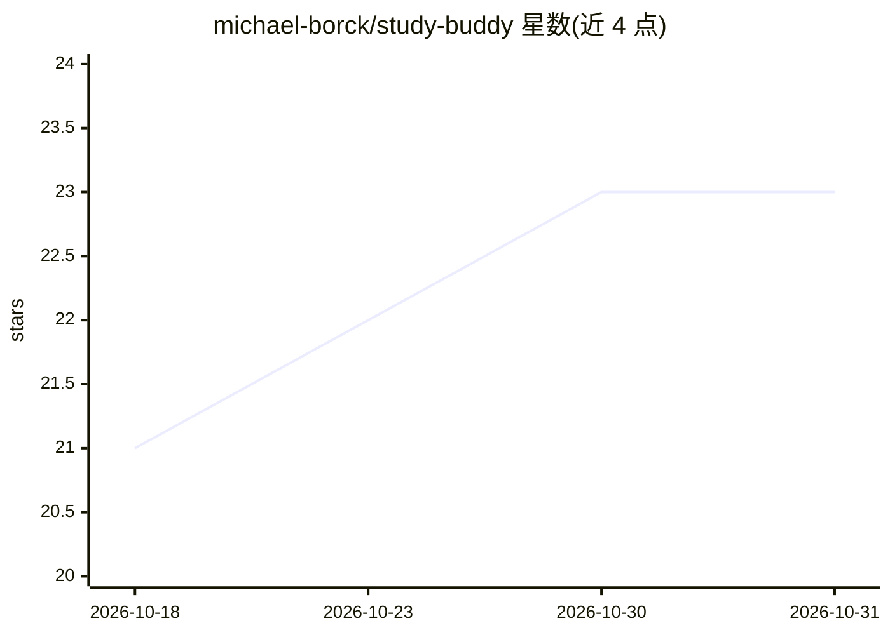

# michael-borck/study-buddy

⭐ 23 · TypeScript · MIT · 推送 2026-08-29 · [GitHub](https://github.com/michael-borck/study-buddy) · 个人维护

**本地离线运行的 AI 个人导师桌面应用，面向学生**

基于 Electron + Next.js 的开源桌面 AI 导师应用，面向大学生（含 ESL 学习者）。每次会话运行轻量 RAG 流程：按主题搜索网页（默认 DuckDuckGo）、读取并按需摘要内容，以所选教育等级进行测验式互动教学，也可粘贴自己的讲义。无持久知识库、无向量存储，每会话重新开始。默认通过 Ollama 本地运行模型，无需联网与账号；也可选接 OpenAI/Anthropic/Google/Groq/Together AI 云端。提供 Windows/macOS/Linux 安装包。

## 筛选速览

| 维度 | 判定 | 备注 |
|---|---|---|
| AI 角色 | `ai-native` | 本体是模型或模型工具 |
| 许可风险 | `permissive` | MIT |
| 部署形态 | `desktop` | 安装包/桌面程序 |
| 模型依赖 | local-ok | 支持本地模型 |
| 硬件要求 | — | 无带数字的原话,不猜 |
| 安装摩擦 | `low` | 无编译、无系统依赖或容器化 |
| 成熟度 | — | 结构信号不足 |

## 能力要点

- 每会话轻量 RAG：搜索网页→读取→按需摘要→分级教学
- 默认经 Ollama 本地推理，模型下载后无需联网、无需账号
- 支持粘贴讲义/教材片段作为学习材料
- 无嵌入与向量库的会话式设计，桌面端提供三平台安装包

## 适用场景

- 学生想就某个主题获得有出处、分等级的私人辅导对话
- 不愿上传数据、希望完全离线使用 AI 导师
- 用自己的课件配合网页来源一起学习

## 场景标签

`AI 助手` · 领域:对话与助手

## 证据(README 行号)

> L5: > An open-source AI personal tutor that runs entirely on your computer. Private by design. Bring your own model.
> L27: Study Buddy is a simple grounded tutor — a lightweight RAG (retrieval-augmented generation) pipeline that runs fres
> L33: 5. **The AI teaches you** from that grounded material at your chosen level, with an interactive quiz-style conversa

## 星数曲线

2026-10-18 21 → 2026-10-31 23（+2）

---
*卡片 v1 · prompt 1.4 · 生成 2026-10-27 · 置信度 mid · 依据 README sha `de7efa9cdf56` · [字段定义](../../DATASET.md)*
