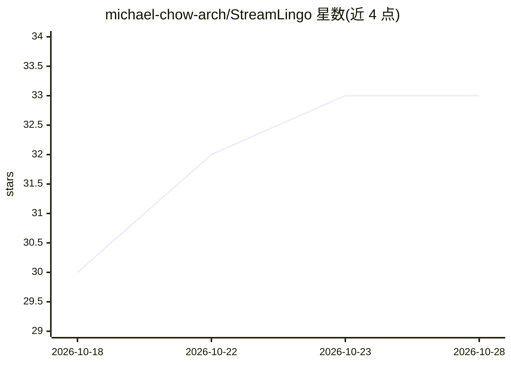

# michael-chow-arch/StreamLingo

⭐ 33 · Python · MIT · 推送 2026-10-13 · [GitHub](https://github.com/michael-chow-arch/StreamLingo) · [官网](https://github.com/michael-chow-arch/StreamLingo/releases/tag/v0.2.0) · 个人维护 · 中文 README

**YouTube 直播实时 AI 翻译字幕工具：本地 Ollama，英中双向**

Chrome 扩展加本地 Python 服务的组合：从浏览器标签页直接采集 YouTube 直播音频，经 WhisperLiveKit/faster-whisper 做语音识别，再调用用户本地已安装的 Ollama 模型翻译，在播放器内显示字幕，无需主播提供字幕。支持英中/中英/自动检测四种模式，默认仅与 127.0.0.1 本地服务通信，无托管翻译服务。提供 Windows 预览版（双击 Setup/Start 脚本），要求 Chrome 116+、Python 3.11–3.13、NVIDIA GPU（CUDA 12 + cuDNN 9）；扩展需开发者模式手动加载，未上架 Chrome Web Store。Linux/macOS 未验证。

## 筛选速览

| 维度 | 判定 | 备注 |
|---|---|---|
| AI 角色 | `ai-native` | 本体是模型或模型工具 |
| 许可风险 | `permissive` | MIT |
| 部署形态 | `desktop` | 安装包/桌面程序 |
| 模型依赖 | local-ok | 支持本地模型 |
| 硬件要求 | — | 无带数字的原话,不猜 |
| 安装摩擦 | `medium` | 含编译或系统依赖之一 |
| 成熟度 | `idea` | |

## 能力要点

- 直接采集浏览器标签页音频，无需麦克风或虚拟声卡
- 四种翻译模式：英→中、中→英、自动→中、自动→英（依赖多语言 Whisper）
- 默认仅本地服务（127.0.0.1），音频与文本不出本机
- Windows 预览版免 Node.js，Setup/Start 双击脚本完成配置与启动

## 适用场景

- 观看无本语言字幕的 YouTube 直播（访谈、发布会、直播对话）
- 用本地 Ollama 模型私有化处理语音翻译，不上传音频
- 对普通 YouTube 视频使用同一条音频翻译管线

## 场景标签

`语音识别` · 领域:感知与多模态

## 证据(README 行号)

> L11: StreamLingo generates **Chinese or English translations directly from livestream audio** and displays them inside t
> L90:   → WhisperLiveKit / faster-whisper
> L91:   → Ollama

## 星数曲线

2026-10-18 30 → 2026-10-28 33（+3）

---
*卡片 v1 · prompt 1.4 · 生成 2026-10-25 · 置信度 mid · 依据 README sha `62610fca0d08` · [字段定义](../../DATASET.md)*
