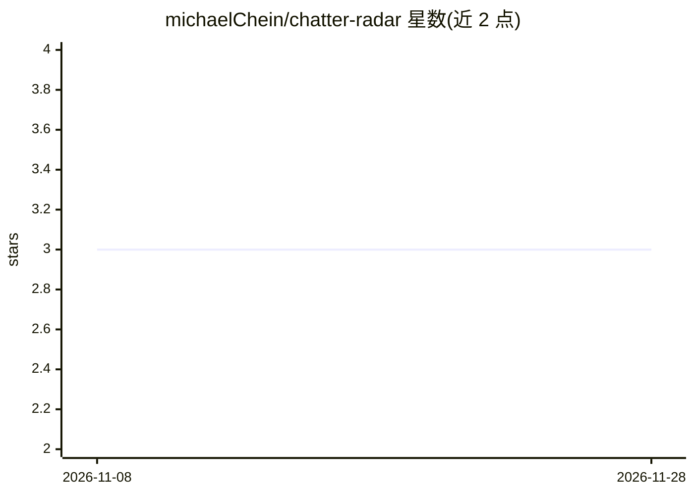

# michaelChein/chatter-radar

⭐ 3 · Python · AGPL-3.0 · 推送 2026-11-26 · [GitHub](https://github.com/michaelChein/chatter-radar) · 个人维护

**自托管应用：从所选 WhatsApp 聊天中提取任务清单**

自托管 Web 应用：Mac 端监听器读取 WhatsApp for Mac 本地数据库中用户选定的聊天，由 Claude 提取待办事项生成任务列表，按逾期/今天/明天等分组展示，并附带可操作数据的聊天助手。用户反馈可经助手生成指令变更提案，通过对历史标注重放评估后经人工批准生效。默认仅支持 macOS 一键安装（无需管理员密码/Homebrew/Docker），也可经 Docker 部署到服务器。需 Anthropic API key，分析按计划运行以控制费用。

## 筛选速览

| 维度 | 判定 | 备注 |
|---|---|---|
| AI 角色 | `ai-native` | 本体是模型或模型工具 |
| 许可风险 | `viral` | AGPL-3.0 |
| 部署形态 | `self-host` | docker 或自建部署 |
| 模型依赖 | locked-api |  |
| 硬件要求 | — | 无带数字的原话,不猜 |
| 安装摩擦 | `low` | 无编译、无系统依赖或容器化 |
| 成熟度 | — | 结构信号不足 |

## 能力要点

- 读取 WhatsApp for Mac 本地数据库，不连接 WhatsApp 服务器、无需添加机器人
- Claude 提取任务并支持照片/PDF 附件分析，语音经 OpenAI 兼容转录端点处理
- 助手只能提案指令变更，提案在历史标注上重放评估后需人工批准
- 紧急消息快速通道与每日定时分析两种模式，附费用估算

## 适用场景

- 从家长群、辅导老师聊天中收集待办与缴费事项
- 用对话助手查询并操作自己的任务数据
- 把 Mac 上的聊天转发到家庭服务器常驻运行

## 场景标签

`AI 助手` · 领域:对话与助手

## 证据(README 行号)

> L3: Chatter Radar is a self-hosted web app that watches chats you choose and turns the messages that matter into a task 
> L5:  How it works: a Mac listener collects messages from WhatsApp for Mac, only from chats you pick. Claude finds what n

## 星数曲线

2026-11-08 3 → 2026-11-28 3（+0）

---
*卡片 v1 · prompt 1.4 · 生成 2026-11-21 · 置信度 high · 依据 README sha `6ada3e2e080f` · [字段定义](../../DATASET.md)*
