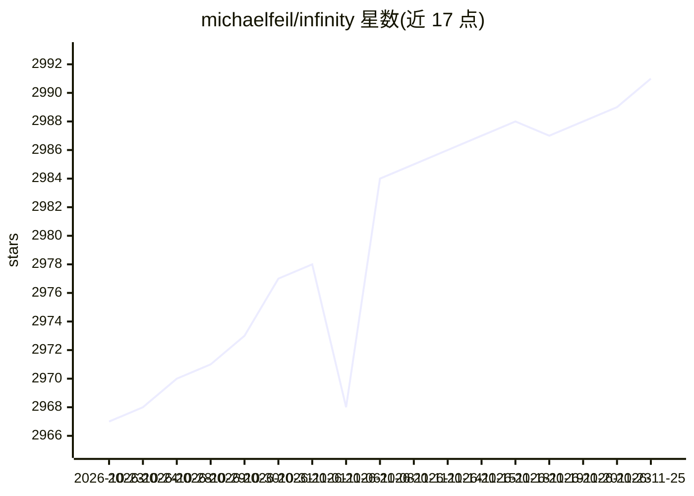

# michaelfeil/infinity

⭐ 2,991 · C++ · MIT · 推送 2026-11-12 · [GitHub](https://github.com/michaelfeil/infinity) · [官网](https://michaelfeil.github.io/infinity/) · 个人维护

**给开发者的 embedding/rerank 模型 REST 推理服务引擎**

通过 REST API 提供 embeddings、reranking、分类与 typed decision 模型服务的引擎。原生 v3 服务器用 Rust 编写，基于 LibTorch（PyTorch 的 C++ 接口）做推理；另有 Python/v2 服务器（infinity-emb 包）支持多模型、多模态及 ONNX、TensorRT 等部署选项。Docker 镜像直接启动服务器，默认使用所有可见 CUDA GPU 并在每个 GPU 上放置完整模型副本；支持 MoE 检查点但每个 GPU 需容纳完整模型。v3 采用自定义 source-available 许可证。

## 筛选速览

| 维度 | 判定 | 备注 |
|---|---|---|
| AI 角色 | `ai-ecosystem` | LLM/agent 周边工具 |
| 许可风险 | `permissive` | MIT |
| 部署形态 | `self-host` | docker 或自建部署 |
| 模型依赖 | — | README 未给出锁定关系 |
| 硬件要求 | — | 无带数字的原话,不猜 |
| 安装摩擦 | `low` | 无编译、无系统依赖或容器化 |
| 成熟度 | — | 结构信号不足 |

## 能力要点

- REST API 覆盖 dense/多模态/token 级 embeddings、rerank、分类、NER、SPLADE 稀疏向量等端点
- v3 原生服务器为 Rust + LibTorch 实现
- Docker 镜像直接启动，默认使用全部可见 CUDA GPU
- 提供交互式 API 文档与 /health 就绪检查

## 适用场景

- 为检索系统部署 embedding 与 rerank 服务
- 统一托管多个文本嵌入模型的推理端点
- 需要序列分类或命名实体识别的推理服务场景

## 场景标签

`推理引擎` · 领域:训练与推理

## 证据(README 行号)

> L3: Infinity serves embeddings, reranking, classification, and typed decision models
> L4: through a REST API. The native v3 server is written in Rust and uses LibTorch,

## 星数曲线

2026-10-23 2,967 → 2026-11-25 2,991（+24）

---
*卡片 v1 · prompt 1.4 · 生成 2026-11-23 · 置信度 high · 依据 README sha `7e401bf25b1f` · [字段定义](../../DATASET.md)*
