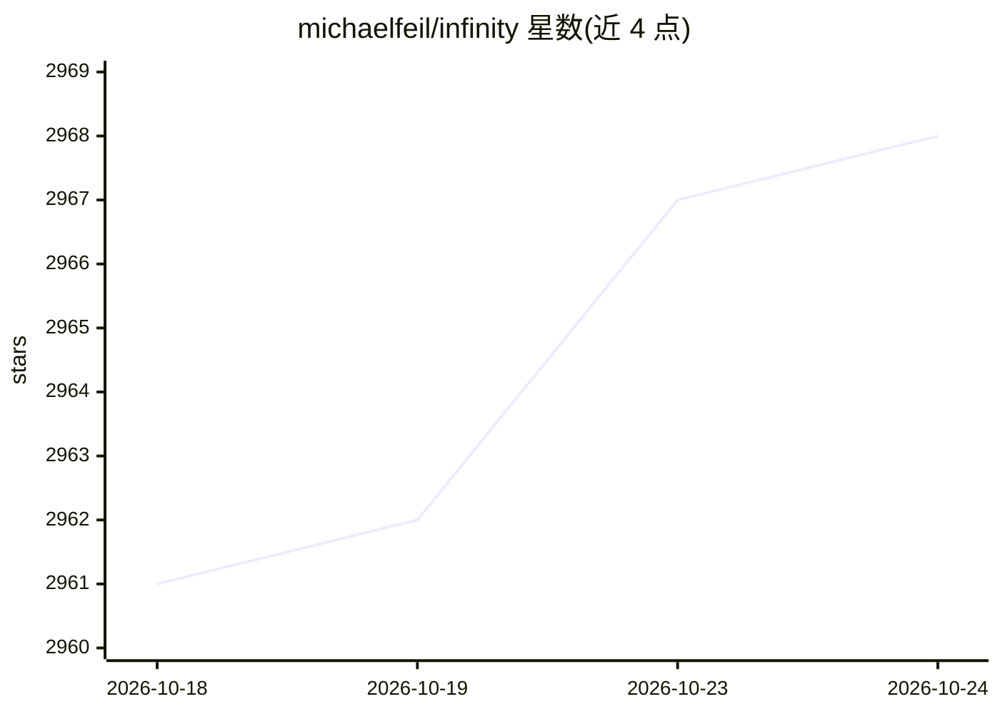

# michaelfeil/infinity

⭐ 2,968 · Rust · MIT · 推送 2026-10-24 · [GitHub](https://github.com/michaelfeil/infinity) · [官网](https://michaelfeil.github.io/infinity/) · 个人维护

**面向开发者的文本嵌入/重排/CLIP 等模型的 REST 推理服务引擎**

基于 FastAPI 的 REST API 推理服务，用于部署 text-embeddings、reranking、CLIP/CLAP、ColBERT/ColPali 及文本分类模型，支持从 HuggingFace 加载多种已验证架构。推理后端可选 PyTorch、optimum（ONNX/TensorRT）与 CTranslate2，使用 FlashAttention 与动态批处理，支持 CUDA、ROCm、CPU、AWS INF2、Apple MPS 等加速器。可通过 pip 或预构建 Docker 镜像安装，v2 CLI 支持环境变量、API key 与多模型同时启动，API 规范对齐 OpenAI 的 embeddings 规格。限制：ctranslate2 引擎仅支持 BERT 模型，ColPali 不支持 LoRA 适配器，纯视觉模型不支持。

## 筛选速览

| 维度 | 判定 | 备注 |
|---|---|---|
| AI 角色 | `ai-ecosystem` | LLM/agent 周边工具 |
| 许可风险 | `permissive` | MIT |
| 部署形态 | `self-host` | docker 或自建部署 |
| 模型依赖 | — | README 未给出锁定关系 |
| 硬件要求 | `cpu-ok` | |
| 安装摩擦 | `low` | 无编译、无系统依赖或容器化 |
| 成熟度 | — | 结构信号不足 |

## 能力要点

- 支持 text-embeddings、reranking、CLIP/CLAP 多模态嵌入、ColBERT/ColPali 晚交互嵌入与文本分类
- 推理后端可选 torch / optimum（ONNX/TensorRT）/ ctranslate2，含动态批处理与 FlashAttention
- v2 CLI 支持多模型混部署、环境变量启动与 --api-key 鉴权，OpenAPI 对齐 OpenAI 规范
- 提供通用、CPU、ROCm、TensorRT-ONNX 等多种 Docker 镜像及 Python asyncio API

## 适用场景

- 私有化部署 OpenAI 风格的文本嵌入与重排服务，用于检索和 RAG
- 在同一服务中混部署多个嵌入/重排/多模态模型
- 用 Docker 在 CPU/CUDA/ROCm 等不同硬件上运行嵌入推理

## 场景标签

`推理引擎` · 领域:训练与推理

## 证据(README 行号)

> L14: Infinity is a high-throughput, low-latency REST API for serving text-embeddings, reranking models, clip, clap and c
> L18: * **Fast inference backends**: The inference server is built on top of PyTorch, optimum (ONNX/TensorRT) and CTransl
> L175: Infinity aims to be the inference server supporting most functionality for embeddings, reranking and related RAG t

## 星数曲线

2026-10-18 2,961 → 2026-10-24 2,968（+7）

---
*卡片 v1 · prompt 1.4 · 生成 2026-10-20 · 置信度 high · 依据 README sha `3def1fdad0f5` · [字段定义](../../DATASET.md)*
