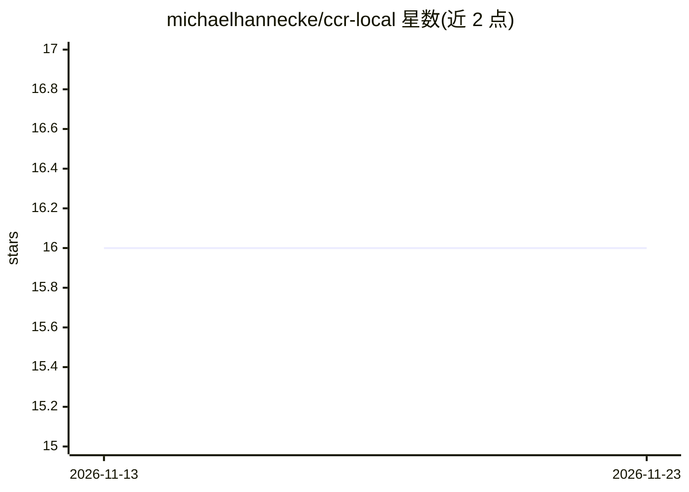

# michaelhannecke/ccr-local

⭐ 16 · JavaScript · MIT · 推送 2026-11-13 · [GitHub](https://github.com/michaelhannecke/ccr-local) · [官网](https://www.bluetuple.ai) · 个人维护

**让 Claude Code 通过 Ollama 使用本地 LLM 的 Docker 路由代理**

以 Docker 容器运行的 API 代理，将 Claude Code 发出的 Anthropic API 调用转换为 OpenAI 兼容格式，转发到宿主机上的 Ollama 本地模型，使 LLM 流量不出本机。提供基于 JSON 的模型路由配置（default/think/background 任务分派不同模型）、容器隔离、只读配置挂载与审计日志。面向 Apple Silicon Mac 用户，需 Docker Desktop、Node.js 18+ 与 Ollama；README 注明本地模型不支持 Extended Thinking，多步工具调用成功率低于 Claude Opus。

## 筛选速览

| 维度 | 判定 | 备注 |
|---|---|---|
| AI 角色 | `ai-ecosystem` | LLM/agent 周边工具 |
| 许可风险 | `permissive` | MIT |
| 部署形态 | `self-host` | docker 或自建部署 |
| 模型依赖 | local-ok | 支持本地模型 |
| 硬件要求 | — | 无带数字的原话,不猜 |
| 安装摩擦 | `low` | 无编译、无系统依赖或容器化 |
| 成熟度 | — | 结构信号不足 |

## 能力要点

- 将 Anthropic API 调用转换为 OpenAI 兼容格式转发至 Ollama
- 按 default/think/background 任务路由到不同本地模型
- Docker 容器隔离运行，仅暴露 localhost 3456 端口
- 所有 LLM 流量保留在本机，无云端传输

## 适用场景

- 在 Apple Silicon Mac 上用本地模型运行 Claude Code 编程
- 隔离运行 API 代理并保护 API 密钥
- 按任务类型切换不同的本地代码模型

## 场景标签

`模型网关` `编码 Agent` · 领域:Agent 开发

## 证据(README 行号)

> L8: Run Claude Code with locally hosted LLMs via Ollama. The routing proxy runs in a Docker container for security isola
> L32: |Claude Code Router|Docker Container|API proxy, transforms Anthropic API to OpenAI format|
> L17: - **Flexible Model Routing** - Configure different models for default, thinking, and background tasks

## 星数曲线

2026-11-13 16 → 2026-11-23 16（+0）

---
*卡片 v1 · prompt 1.4 · 生成 2026-11-18 · 置信度 mid · 依据 README sha `69b6646677b8` · [字段定义](../../DATASET.md)*
