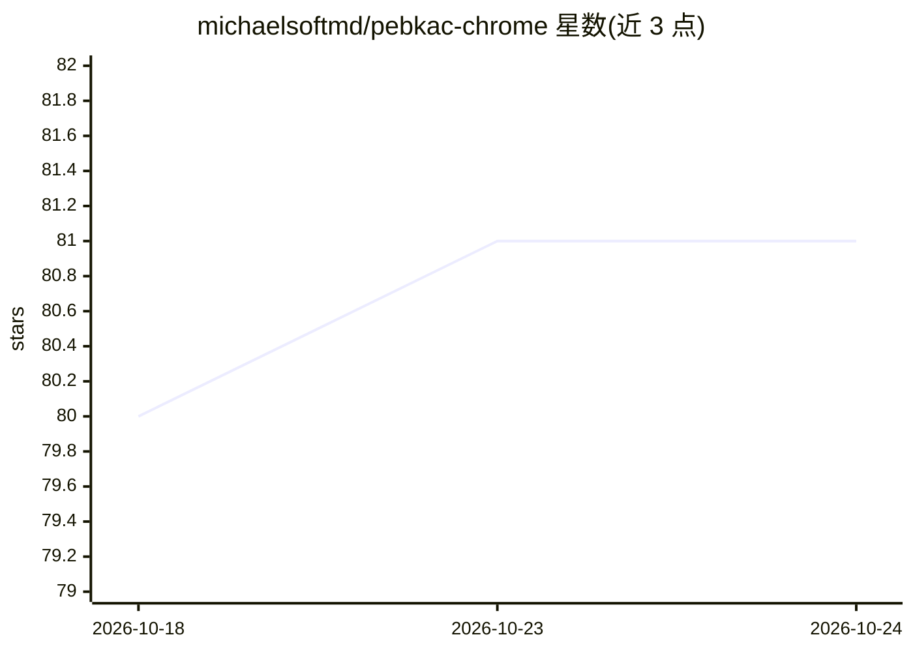

# michaelsoftmd/pebkac-chrome

⭐ 81 · Python · AGPL-3.0 · 推送 2026-04-14 · [GitHub](https://github.com/michaelsoftmd/pebkac-chrome) · [官网](https://akickintheteeth.com) · 个人维护

**本地 LLM 驱动的网页协作浏览/自动化服务**

基于 SmolAgents 与 Zendriver 的 Web 'nonautomation' 框架：LLM 通过直接编写 Python 代码控制真实 Chrome 浏览器，在最多 10 个可配置步骤内自主完成导航、点击、表单填写、内容提取（Trafilatura）与截图等任务。用户在 localhost:8888 的聊天界面下达自然语言指令，可通过 noVNC 观看并随时人工接管，形成人机协作浏览。带 Redis+DuckDB 两层缓存、SQLite 执行历史与 CSS 选择器学习。设计为在廉价 GPU/小型 MiniPC 上配合本地 LLM（推荐 llama.cpp 调整）运行；作者自述为非专业开发者（vibe coding），README 声明项目已搁置。

## 筛选速览

| 维度 | 判定 | 备注 |
|---|---|---|
| AI 角色 | `ai-native` | 本体是模型或模型工具 |
| 许可风险 | `viral` | AGPL-3.0 |
| 部署形态 | `self-host` | docker 或自建部署 |
| 模型依赖 | — | README 未给出锁定关系 |
| 硬件要求 | — | 无带数字的原话,不猜 |
| 安装摩擦 | `low` | 无编译、无系统依赖或容器化 |
| 成熟度 | — | 结构信号不足 |

## 能力要点

- LLM 直接编写 Python 代码控制浏览器（循环/条件/错误处理）
- 通过 noVNC 实时观看浏览器并可人工协作接管
- Redis+DuckDB 两层缓存与 CSS 选择器跨重启学习
- Trafilatura 智能内容提取与 API 响应捕获

## 适用场景

- 让本地 LLM 代为完成网页浏览、搜索与信息收集
- 人工登录后让 agent 在页面上执行后续操作
- 以对话方式自动填表、截图、导出 markdown

## 场景标签

`浏览器自动化` `网页抓取` · 领域:效率与自动化

## 证据(README 行号)

> L13: pebkac browses the web for you. It is a web nonautomation framework powered by SmolAgents and Zendriver. Synchronou
> L42: - 💬 **Chat Interface** - Type natural language commands at localhost:8888
> L67: You operate it simply by opening the pebkac Control Panel in your browser (localhost:8888) and typing into the chat

## 星数曲线

2026-10-18 80 → 2026-10-24 81（+1）

---
*卡片 v1 · prompt 1.4 · 生成 2026-10-24 · 置信度 high · 依据 README sha `0de39cc18a53` · [字段定义](../../DATASET.md)*
