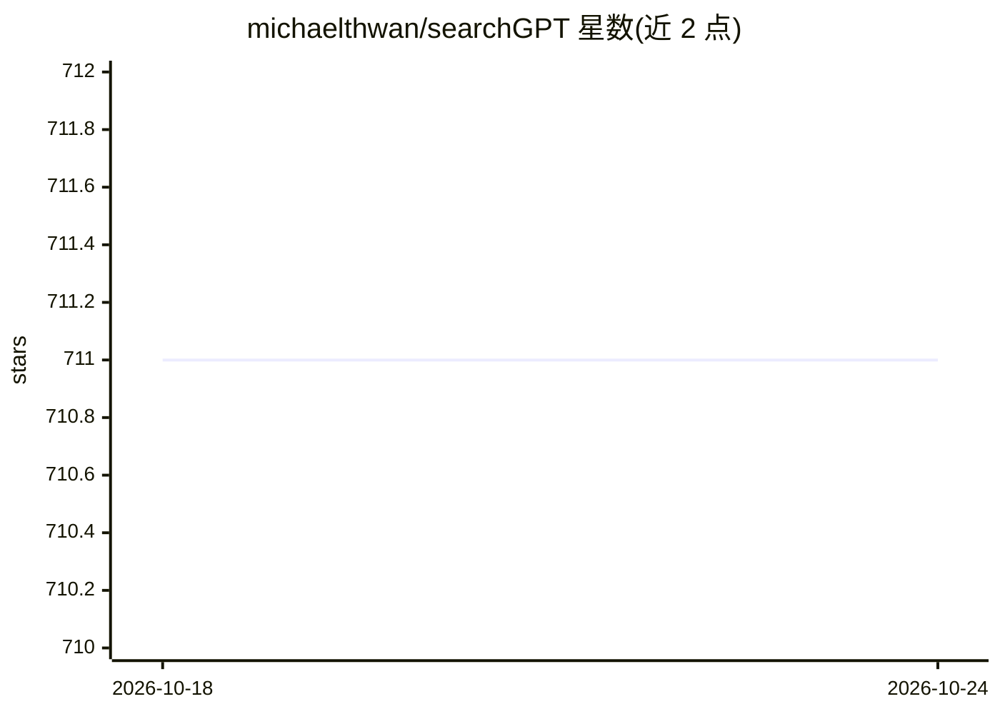

# michaelthwan/searchGPT

⭐ 711 · Python · MIT · 推送 2026-09-22 · [GitHub](https://github.com/michaelthwan/searchGPT) · 个人维护

**基于 LLM 的有出处搜索引擎，支持网页与文件内容搜索**

开源项目，构建以 LLM 回答自然语言问题的搜索引擎，回答附带来源引用（grounded）。支持实时网页搜索（Azure Bing Search API）、文件内容搜索（PPT/DOC/DOCX/PPTX 等），并使用 OpenAI embeddings 做语义检索（FAISS / pyterrier 代码已注释）。LLM 端支持 OpenAI / GooseAI API，提供 Web 前端。需 Python 3.10.8 与相应 API Key，pip 安装依赖后运行 app.py。项目已归档，不再维护。

## 筛选速览

| 维度 | 判定 | 备注 |
|---|---|---|
| AI 角色 | `ai-native` | 本体是模型或模型工具 |
| 许可风险 | `permissive` | MIT |
| 部署形态 | `library` | 以包/库形式分发 |
| 模型依赖 | — | README 未给出锁定关系 |
| 硬件要求 | — | 无带数字的原话,不猜 |
| 安装摩擦 | `low` | 无编译、无系统依赖或容器化 |
| 成熟度 | — | 结构信号不足 |

## 能力要点

- 回答附带编号来源引用（grounded 搜索）
- 实时网页搜索与 Office 文档内容搜索
- OpenAI embeddings 语义检索（FAISS / pyterrier 路径当前被注释）
- 提供 Web 前端与 stdout 两种运行方式

## 适用场景

- 我想让 LLM 基于实时网页内容给出带出处的回答
- 我想对自己电脑里的 PPT/Word 文档做问答搜索
- 我想对比有/无检索依据的 LLM 回答差异

## 场景标签

`语义搜索` `文档问答` · 领域:知识与检索

## 证据(README 行号)

> L3: **searchGPT** is an open-source project to build a search engine based on Large Language Model (LLM) technology to g
> L22: * LLM integration: (OpenAI / GooseAI, etc.)

## 星数曲线

2026-10-18 711 → 2026-10-24 711（+0）

---
*卡片 v1 · prompt 1.4 · 生成 2026-10-21 · 置信度 high · 依据 README sha `2be978bdf86c` · [字段定义](../../DATASET.md)*
