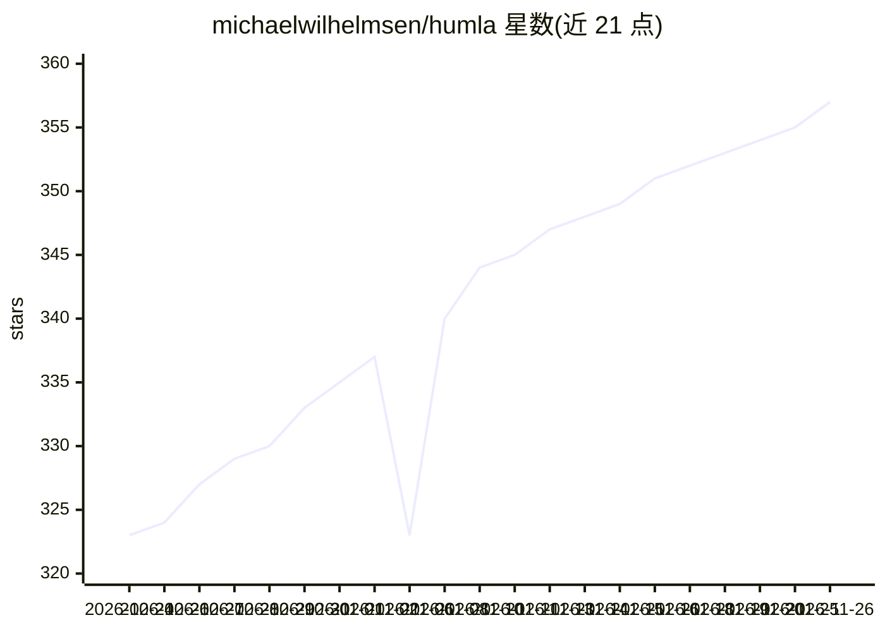

# michaelwilhelmsen/humla

⭐ 357 · Rust · MIT · 推送 2026-11-25 · [GitHub](https://github.com/michaelwilhelmsen/humla) · [官网](https://humla.team) · 个人维护

**macOS 本地优先会议笔记应用：录音转写并生成摘要**

面向 macOS（Apple Silicon）的会议笔记应用，受 Granola 启发：同时录制麦克风与系统音频两路流，在本机完成转写与说话人分离，并把用户手写笔记与转写合并生成结构化摘要（预设 Meeting/1:1/Lecture 等场景）。转写可按语言混搭 Local Whisper、OpenAI、Deepgram、Groq；摘要与问答可指向 Ollama、LM Studio、llama.cpp、vLLM 等本地服务器。内置 MCP 服务器（六个只读工具）供 Claude Code、Codex 等客户端检索笔记。团队同步为可选付费云服务或自托管 PocketBase。

## 筛选速览

| 维度 | 判定 | 备注 |
|---|---|---|
| AI 角色 | `ai-native` | 本体是模型或模型工具 |
| 许可风险 | `permissive` | MIT |
| 部署形态 | `desktop` | 安装包/桌面程序 |
| 模型依赖 | local-ok | 支持本地模型 |
| 硬件要求 | — | 无带数字的原话,不猜 |
| 安装摩擦 | `low` | 无编译、无系统依赖或容器化 |
| 成熟度 | `idea` | |

## 能力要点

- 双流录音（麦克风+系统音频）与离线说话人识别（Nemotron 3 / Community-1）
- 转写引擎可按语言覆盖：Local Whisper、OpenAI、Deepgram、Groq
- 摘要以 [Notater]/[Transkripsjon] 双输入融合手写笔记与转写
- 内置只读 MCP 服务器与混合检索（关键词+语义）的笔记问答，答案带引用

## 适用场景

- 远程会议中分别记录我和对方的发言，生成干净转写
- 全部用本地模型处理敏感会议，数据不出本机
- 会后向历史笔记提问并核对引用出处
- 让 Claude Code 直接检索我的会议纪要

## 场景标签

`语音识别` `文档问答` · 领域:知识与检索

## 证据(README 行号)

> L27: **Humla** is a meeting-notes app for macOS, inspired by Granola. You take freeform notes during your meeting; Humla
> L29: Built around one principle: **your audio and your data stay on your machine** unless you explicitly send them somew
> L46: - **Local Whisper** — runs entirely on your Mac via Apple Silicon's GPU. Free after a one-time download. Multiple m

## 星数曲线

2026-10-24 323 → 2026-11-26 357（+34）

---
*卡片 v1 · prompt 1.4 · 生成 2026-11-25 · 置信度 mid · 依据 README sha `fbd07cf1db50` · [字段定义](../../DATASET.md)*
