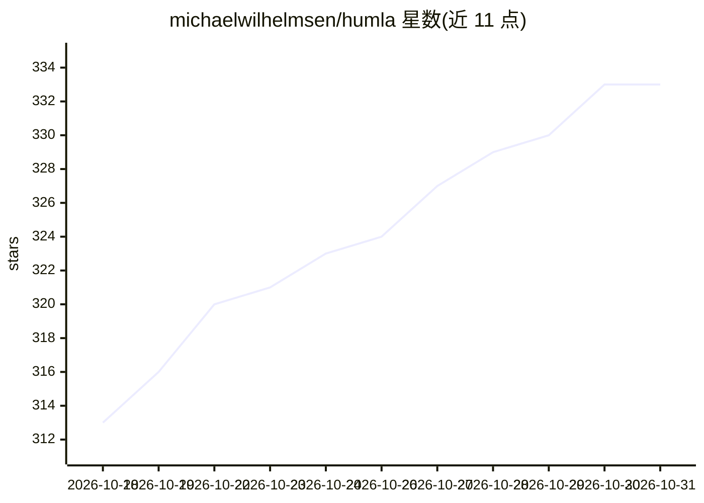

# michaelwilhelmsen/humla

⭐ 333 · Rust · MIT · 推送 2026-10-29 · [GitHub](https://github.com/michaelwilhelmsen/humla) · [官网](https://humla.team) · 个人维护

**macOS 本地优先的开源 AI 会议笔记应用：录音转写与摘要**

面向 macOS 用户的会议笔记应用（Tauri 2 + Rust + Swift，MIT 许可）。同时录制麦克风与系统音频两路流，转录可选本地 Whisper（Apple Silicon GPU 运行）、OpenAI、Deepgram、Groq，可按语言混配引擎；离线说话人分离（Nematron 3 默认 / pyannote 聚类）；摘要将用户笔记与转写作为两个标注输入交给 OpenAI 或任意 OpenAI 兼容本地服务器（Ollama、LM Studio、llama.cpp、vLLM）。另带基于混合检索的笔记问答（带引用）与只读 MCP 服务器供 Claude Code 等客户端查询。数据存本机 SQLite，可选 PocketBase 同步（托管付费 $5/用户/月或自托管免费）。

## 筛选速览

| 维度 | 判定 | 备注 |
|---|---|---|
| AI 角色 | `ai-native` | 本体是模型或模型工具 |
| 许可风险 | `permissive` | MIT |
| 部署形态 | `desktop` | 安装包/桌面程序 |
| 模型依赖 | local-ok | 支持本地模型 |
| 硬件要求 | — | 无带数字的原话,不猜 |
| 安装摩擦 | `low` | 无编译、无系统依赖或容器化 |
| 成熟度 | — | 结构信号不足 |

## 能力要点

- 麦克风与系统音频双流录制，保持“我说/对方说”可区分
- 本地 Whisper / OpenAI / Deepgram / Groq 转录引擎按语言混配
- 离线说话人识别（最多 8 人）+ 笔记与转写融合摘要
- 笔记问答带引用与可审计检索过程；内置只读 MCP 服务器（6 个工具）

## 适用场景

- 开会时边记笔记边自动获得带说话人标签的转写与结构化摘要
- 敏感会议全程本地运行（本地 Whisper + 本地 LLM）不出机器
- 在 Claude Code 等 agent 中检索自己的会议记录
- 小团队通过自托管 PocketBase 同步共享工作区

## 场景标签

`语音识别` `知识库管理` `文档问答` · 领域:知识与检索

## 证据(README 行号)

> L27: **Humla** is a meeting-notes app for macOS, inspired by Granola. You take freeform notes during your meeting; Humla
> L46: - **Local Whisper** — runs entirely on your Mac via Apple Silicon's GPU. Free after a one-time download. Multiple m
> L61: ### Summarises with both your notes and the transcript

## 星数曲线

2026-10-18 313 → 2026-10-31 333（+20）

---
*卡片 v1 · prompt 1.4 · 生成 2026-10-21 · 置信度 mid · 依据 README sha `19f6257b61da` · [字段定义](../../DATASET.md)*
