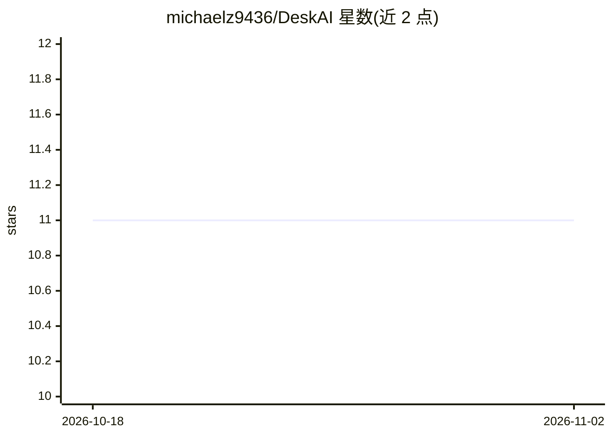

# michaelz9436/DeskAI

⭐ 11 · Python · MIT · 推送 2026-03-11 · [GitHub](https://github.com/michaelz9436/DeskAI) · 个人维护 · 中文 README

**桌面 AI 悬浮球助手：快捷键截图识别、文件分析与个性化记忆库**

面向个人用户的 Windows 桌面悬浮球工具：通过全局快捷键截屏或读取剪贴板，或将图片、PDF、Word、PPT 等文件拖拽至悬浮球，调用 Gemini、OpenAI、Claude、DeepSeek 的云端 API 完成识别、翻译、总结等任务。支持自定义记忆库（个人信息/偏好/任务）、图形化设置、系统托盘集成。首次运行需手动编辑 config.json 填入 API Key；截图内容会上传至模型 API 服务器。README 声明因 Gemini 免费额度缩水不再维护。

## 筛选速览

| 维度 | 判定 | 备注 |
|---|---|---|
| AI 角色 | `ai-native` | 本体是模型或模型工具 |
| 许可风险 | `permissive` | MIT |
| 部署形态 | `None` |  |
| 模型依赖 | locked-api |  |
| 硬件要求 | — | 无带数字的原话,不猜 |
| 安装摩擦 | `low` | 无编译、无系统依赖或容器化 |
| 成熟度 | — | 结构信号不足 |

## 能力要点

- 悬浮球拖拽分析图片/PDF/Word/PPT 等文件
- 全局自定义快捷键触发截图识别与剪贴板处理
- 多供应商 API 调用：Gemini/OpenAI/Claude/DeepSeek
- 个性化记忆库与图形化设置界面

## 适用场景

- 快捷键截图快速翻译或识别屏幕内容
- 拖拽文档到悬浮球生成要点总结
- 带着个人偏好记忆进行日常 AI 对话

## 场景标签

`AI 助手` `OCR` · 领域:对话与助手

## 证据(README 行号)

> L16: 欢迎使用 DeskAI 屏幕助手！本工具可以通过自定义快捷键，快速截屏或使用剪贴板内容，或将文件/文本拖至悬浮球，调用 AI 大模型进行文字识别、翻译或任何你指定的任务。本项目支持自定义记忆库，帮助你更个性化地完成工作！
> L18: 目前支持 Gemini，openai，Claude，Deepseek 多种模型的 API 调用！

## 星数曲线

2026-10-18 11 → 2026-11-02 11（+0）

---
*卡片 v1 · prompt 1.4 · 生成 2026-11-02 · 置信度 high · 依据 README sha `2f632b841028` · [字段定义](../../DATASET.md)*
