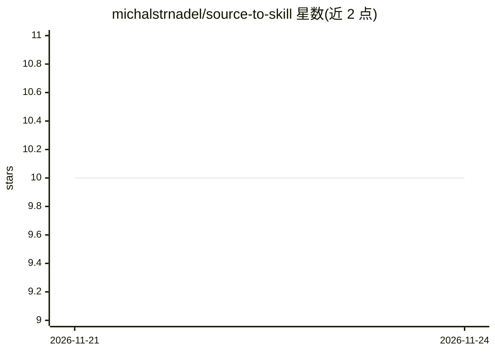

# michalstrnadel/source-to-skill

⭐ 10 · Python · MIT · 推送 2026-10-26 · [GitHub](https://github.com/michalstrnadel/source-to-skill) · [官网](https://michalstrnadel.github.io/source-to-skill/) · 个人维护

**把视频/播客/论文/文档蒸馏为 agent 技能的工具**

将 YouTube 视频、播客、arXiv 论文、EPUB 书籍、llms.txt 文档站、本地录音与个人笔记等来源，经确定性 Python 提取器规范化后，由用户自己的 agent 按模板蒸馏为 SKILL.md 格式的 agent 技能。答案引用来源并深链到精确秒级时间点；转录用本地 Whisper，不调用云 API、无需 API key。支持 Claude Code、Codex、Cursor、Gemini CLI 等多种宿主安装，附带 skill-study/skill-eval/skill-library 三个配套技能与内置评测文件。

## 筛选速览

| 维度 | 判定 | 备注 |
|---|---|---|
| AI 角色 | `ai-ecosystem` | LLM/agent 周边工具 |
| 许可风险 | `permissive` | MIT |
| 部署形态 | `library` | 以包/库形式分发 |
| 模型依赖 | — | README 未给出锁定关系 |
| 硬件要求 | — | 无带数字的原话,不猜 |
| 安装摩擦 | `medium` | 含编译或系统依赖之一 |
| 成熟度 | — | 结构信号不足 |

## 能力要点

- 多来源（视频/播客/论文/书籍/文档/笔记/会议记录）一键生成 SKILL.md 技能
- 答案引用来源并对视频/音频深链到精确秒（&t=842s）
- 本地 Whisper 转录，不调用云 API，无需 API key
- 每个生成的技能自带 evals/evals.json 评测文件

## 适用场景

- 把两小时讲座或播客变成可被编码 agent 按需加载的知识技能
- 为团队会议记录生成决策与行动项索引
- 构建跨 Claude Code/Codex/Cursor 使用的个人知识库

## 场景标签

`知识库管理` `文档问答` · 领域:知识与检索

## 证据(README 行号)

> L5: **Turn YouTube videos, podcasts, papers, books, docs sites, and your own notes into AI agent skills.**
> L173: The work is split in two halves. A **deterministic extractor** (Python, standard library plus optional `yt-dlp`, `

## 星数曲线

2026-11-21 10 → 2026-11-24 10（+0）

---
*卡片 v1 · prompt 1.4 · 生成 2026-11-21 · 置信度 high · 依据 README sha `ad84360bdaed` · [字段定义](../../DATASET.md)*
