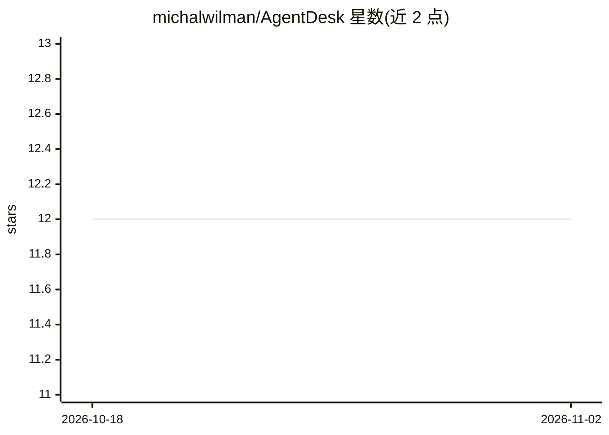

# michalwilman/AgentDesk

⭐ 12 · TypeScript · NOASSERTION · 推送 2025-11-08 · [GitHub](https://github.com/michalwilman/AgentDesk) · 个人维护

**面向企业的多渠道 AI 聊天机器人 SaaS 平台（RAG+行动）**

基于 Next.js/NestJS/TypeScript 的多租户 SaaS 平台，用于构建部署企业聊天机器人：通过 pgvector 语义检索与 GPT-4o-mini 实现 RAG 问答，可从网站自动抓取内容建立知识库；Agent 可执行 Google Calendar 预约、邮件通知、WhatsApp/Twilio 消息、线索捕获等动作，并部署到 Web 组件、WordPress 插件、Telegram 与 WhatsApp 渠道。内置订阅计费、用量限制、多租户 RLS 与审计日志。采用 BSL 1.1 许可，非商业及年收入低于 100 万美元公司免费，2028 年转为 MIT。

## 筛选速览

| 维度 | 判定 | 备注 |
|---|---|---|
| AI 角色 | `ai-native` | 本体是模型或模型工具 |
| 许可风险 | `none` | NOASSERTION |
| 部署形态 | `desktop` | 安装包/桌面程序 |
| 模型依赖 | — | README 未给出锁定关系 |
| 硬件要求 | — | 无带数字的原话,不猜 |
| 安装摩擦 | `low` | 无编译、无系统依赖或容器化 |
| 成熟度 | — | 结构信号不足 |

## 能力要点

- pgvector 语义检索 + GPT-4o-mini 的 RAG 知识库（网站自动抓取索引）
- AI Agent 行动：预约排期、邮件自动化、WhatsApp/SMS、线索捕获
- 多渠道部署：Web 组件、WordPress 插件、Telegram、WhatsApp
- 多租户架构与 PostgreSQL 行级安全、订阅计费与用量限制

## 适用场景

- 在我的网站和 WhatsApp/Telegram 上部署能回答业务问题的 AI 客服
- 让 AI 代理自动完成预约排期与线索跟进
- 从自有网站与文档内容自动构建问答知识库

## 场景标签

`聊天机器人` `文档问答` · 领域:对话与助手

## 证据(README 行号)

> L23: |🤖 Scripted responses|🧠 **Learns** from your content (RAG)|
> L36: - **GPT-4o-mini** for natural conversations
> L123: - LLM: OpenAI GPT-4o-mini

## 星数曲线

2026-10-18 12 → 2026-11-02 12（+0）

---
*卡片 v1 · prompt 1.4 · 生成 2026-11-01 · 置信度 high · 依据 README sha `a943268928b1` · [字段定义](../../DATASET.md)*
