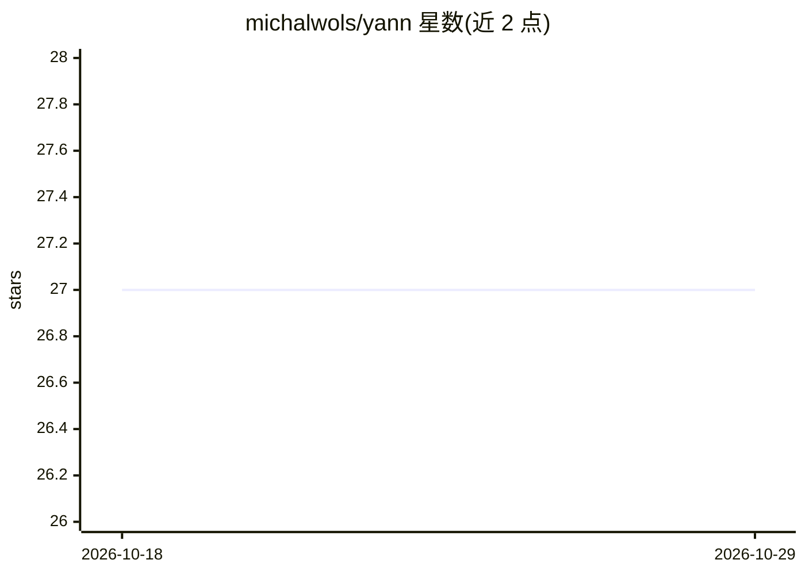

# michalwols/yann

⭐ 27 · Python · MIT · 推送 2026-07-21 · [GitHub](https://github.com/michalwols/yann) · [官网](https://michalwols.github.io/yann/) · 个人维护

**torch.nn 扩展库：为模型训练添加便捷封装**

基于 PyTorch 的 Python 库，定位为 torch.nn 的扩展版本，目标是让模型训练更快更容易。示例演示用其训练 LeNet 识别 MNIST，自动从代码生成带参数的命令行接口（优化器、学习率、批大小、轮数、随机种子等可配置），训练运行时向 stdout 打印参数汇总。通过 pip 安装，面向使用 PyTorch 的开发者。

## 筛选速览

| 维度 | 判定 | 备注 |
|---|---|---|
| AI 角色 | `ai-ecosystem` | LLM/agent 周边工具 |
| 许可风险 | `permissive` | MIT |
| 部署形态 | `library` | 以包/库形式分发 |
| 模型依赖 | — | README 未给出锁定关系 |
| 硬件要求 | — | 无带数字的原话,不猜 |
| 安装摩擦 | `low` | 无编译、无系统依赖或容器化 |
| 成熟度 | — | 结构信号不足 |

## 能力要点

- 对 torch.nn 的扩展封装
- 从训练代码自动生成 CLI（-o/-lr/-bs/-e/-s 等参数）
- 示例覆盖 MNIST 上的 LeNet 训练
- 训练时打印参数汇总

## 适用场景

- 用 PyTorch 快速搭建并启动训练脚本
- 通过自动生成的命令行参数调整训练配置

## 场景标签

 · 领域:深度学习/工具库

## 证据(README 行号)

> L3:  Yann is an extended version of torch.nn, adding a ton of sugar to make training models as fast and easy as possible

## 星数曲线

2026-10-18 27 → 2026-10-29 27（+0）

---
*卡片 v1 · prompt 1.4 · 生成 2026-10-26 · 置信度 mid · 依据 README sha `e13898405478` · [字段定义](../../DATASET.md)*
