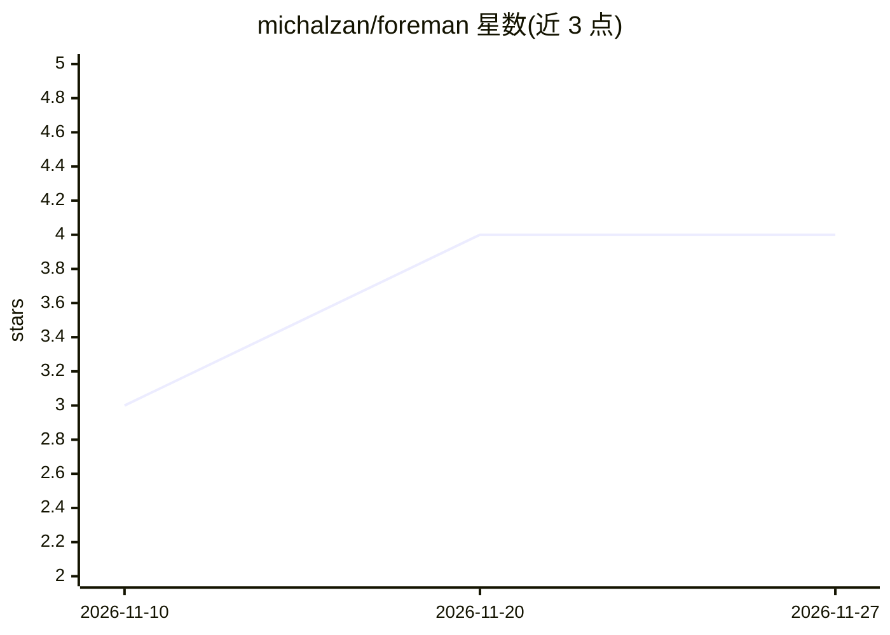

# michalzan/foreman

⭐ 4 · Python · MIT · 推送 2026-11-11 · [GitHub](https://github.com/michalzan/foreman) · 个人维护

**让 Claude Code 无人值守运行持续干活的 hooks 管家插件**

一个 Claude Code 插件，通过 Stop/PreToolUse/SessionStart 等钩子治理无人值守编码会话：项目检查通过且计划推进、并由第二个模型（默认 Haiku）认可停止理由后，会话才被允许停止；连续 3 次拒绝后放行并记录原因。附带门禁自证（canary）、每单元提交、决策日志、保护分支/自身文件守卫与会话体检。作者自述为个人工具，九次运行、约 70 个单元，钩子依赖特定版本行为，后续版本可能失效。

## 筛选速览

| 维度 | 判定 | 备注 |
|---|---|---|
| AI 角色 | `ai-ecosystem` | LLM/agent 周边工具 |
| 许可风险 | `permissive` | MIT |
| 部署形态 | `self-host` | docker 或自建部署 |
| 模型依赖 | — | README 未给出锁定关系 |
| 硬件要求 | — | 无带数字的原话,不猜 |
| 安装摩擦 | `low` | 无编译、无系统依赖或容器化 |
| 成熟度 | `idea` | |

## 能力要点

- 停止门禁：检查通过、计划推进、评审模型同意三者齐备才允许停止
- /foreman:init 用 canary 证明每个检查门禁真的能失败
- Guard 钩子在保护分支推送、PR 合并、git clean -x 等操作前强制确认
- 每单元提交、决策日志与运行报告，回来看到的是报告而非聊天记录

## 适用场景

- 放下已评审的计划，让 Claude Code 在本机连续完成多个工作单元
- 减少长会话中频繁的"接下来做什么/要不要提交"确认打断
- 审计项目检查命令是否真的能在代码损坏时报错
- 对无人值守运行做事后审查并生成可提交 issue 的报告

## 场景标签

`编码 Agent` · 领域:编码与开发

## 证据(README 行号)

> L9: Claude Code can already do hours of planned work on its own. What stops it is that it hands control back too early: 
> L78: It is a Claude Code plugin. This repository is both the plugin and a one-plugin marketplace. From GitHub:

## 星数曲线

2026-11-10 3 → 2026-11-27 4（+1）

---
*卡片 v1 · prompt 1.4 · 生成 2026-11-21 · 置信度 mid · 依据 README sha `7e38f53e858d` · [字段定义](../../DATASET.md)*
