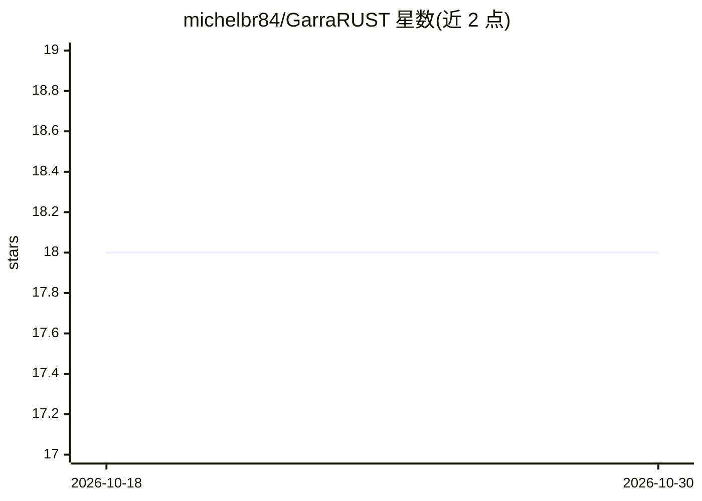

# michelbr84/GarraRUST

⭐ 18 · Rust · MIT · 推送 2026-10-29 · [GitHub](https://github.com/michelbr84/GarraRUST) · [官网](https://garraia.org) · 个人维护

**运行在本机的个人 AI 助手，单二进制接入多个聊天平台**

用 Rust 编写的本地个人 AI agent 助手：单个自包含二进制在 Telegram、Discord、Slack、WhatsApp、iMessage 上运行 agent。提供 AES-256-GCM 加密凭据库、热配置重载、带本地嵌入的完整记忆系统；默认使用巴西葡萄牙语人格，可配置为中性英语。本地优先：全部状态存于本机，无遥测；默认 OpenRouter 为主、本地 Ollama 为备，可配置任意 OpenAI 兼容服务器实现离线。安装提供 Linux/macOS/Windows/Android(Termux) 预编译二进制、deb/rpm/AppImage、MSI 桌面应用及安装脚本，预编译 Linux 二进制要求 glibc 2.35（Ubuntu 22.04+），更旧系统需源码编译。README 含与其他框架的测量对比数据。

## 筛选速览

| 维度 | 判定 | 备注 |
|---|---|---|
| AI 角色 | `ai-native` | 本体是模型或模型工具 |
| 许可风险 | `permissive` | MIT |
| 部署形态 | `desktop` | 安装包/桌面程序 |
| 模型依赖 | local-ok | 支持本地模型 |
| 硬件要求 | — | 无带数字的原话,不猜 |
| 安装摩擦 | `low` | 无编译、无系统依赖或容器化 |
| 成熟度 | — | 结构信号不足 |

## 能力要点

- 单二进制运行于 Telegram/Discord/Slack/WhatsApp/iMessage 五个平台
- AES-256-GCM 加密凭据库与热配置重载
- 本地优先：状态全存本机、无遥测，可配 Ollama 全离线
- 多平台预编译二进制 + 安装脚本 + 自更新/回滚

## 适用场景

- 在本机运行接入 Telegram/WhatsApp 等聊天平台的个人 AI 助手
- 配置本地 Ollama 实现零外联的离线 agent
- 在 Android Termux 或低配设备上运行轻量 agent

## 场景标签

`AI 助手` · 领域:对话与助手

## 证据(README 行号)

> L28: **A personal AI assistant that runs on your machine.** One self-contained
> L29: native binary runs your agents on Telegram, Discord, Slack, WhatsApp and
> L44: Ollama for a fully offline setup (set

## 星数曲线

2026-10-18 18 → 2026-10-30 18（+0）

---
*卡片 v1 · prompt 1.4 · 生成 2026-10-29 · 置信度 mid · 依据 README sha `64b825512b6c` · [字段定义](../../DATASET.md)*
