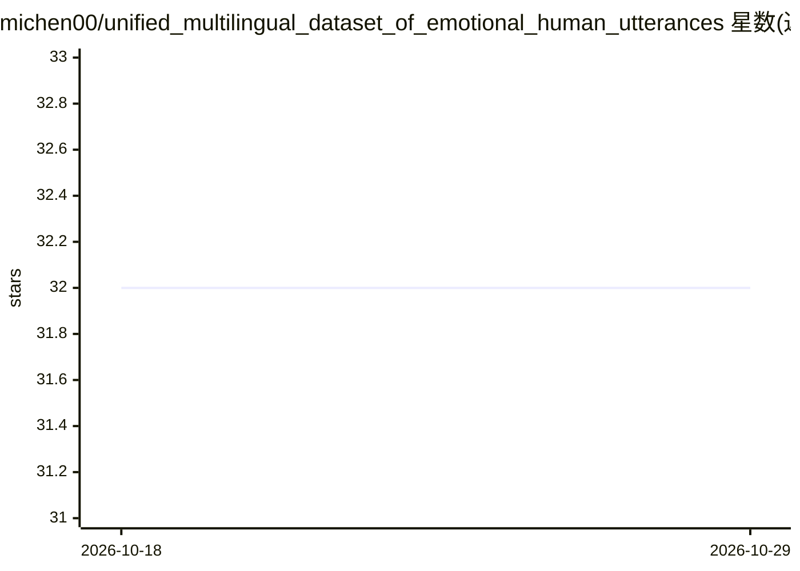

# michen00/unified_multilingual_dataset_of_emotional_human_utterances

⭐ 32 · Jupyter Notebook · NOASSERTION · 推送 2026-01-16 · [GitHub](https://github.com/michen00/unified_multilingual_dataset_of_emotional_human_utterances) · 个人维护

**多语言情感语音统一数据集：87,146 条带情感标注的音频**

将 27 个数据源（9 种语言，含英语、汉语、阿拉伯语、德语等）的情感语音统一整理为一个数据集：87,146 条音频（约 71.76 小时，约 7.8 GB），统一为 16 kHz、16 位 PCM 编码的 .wav 格式，并做音量归一化、静音修剪、时长过滤（0.2–60 秒）等预处理。每条样本标注说话人性别、情感类别、效价及唯一说话人 ID 与时长；效价标注通过情感标签映射与感知分数核验完成。部分数据源因许可限制未纳入核心数据集（N=83,545）。面向语音情感识别方向的研究者。

## 筛选速览

| 维度 | 判定 | 备注 |
|---|---|---|
| AI 角色 | `ai-knowledge` | 知识聚合/清单类 |
| 许可风险 | `none` | NOASSERTION |
| 部署形态 | `None` |  |
| 模型依赖 | — | README 未给出锁定关系 |
| 硬件要求 | — | 无带数字的原话,不猜 |
| 安装摩擦 | `medium` | 含编译或系统依赖之一 |
| 成熟度 | — | 结构信号不足 |

## 能力要点

- 87,146 条样本、9 种语言、27 个数据源统一格式
- 标注包含情感类别、效价、说话人性别与唯一 ID
- 统一预处理：16 kHz、16 位 PCM、音量归一化、前导静音修剪、时长过滤
- 效价标注经情感标签映射与感知分数对齐核验

## 适用场景

- 训练或评测跨语言语音情感识别模型
- 开展情感效价（正/中/负）分类研究
- 复用统一格式的多源情感语音语料做对比实验

## 场景标签

 · 领域:语音情感识别/数据集

## 证据(README 行号)

> L12: The Unified Multilingual Dataset of Emotional Human Utterances provides 87,364 audio files of emotional human utter
> L14: This dataset builds on prior research by unifying a broad set of multilingual data sources curated by [[1]](#1): 13

## 星数曲线

2026-10-18 32 → 2026-10-29 32（+0）

---
*卡片 v1 · prompt 1.4 · 生成 2026-10-26 · 置信度 high · 依据 README sha `6b554086eab1` · [字段定义](../../DATASET.md)*
