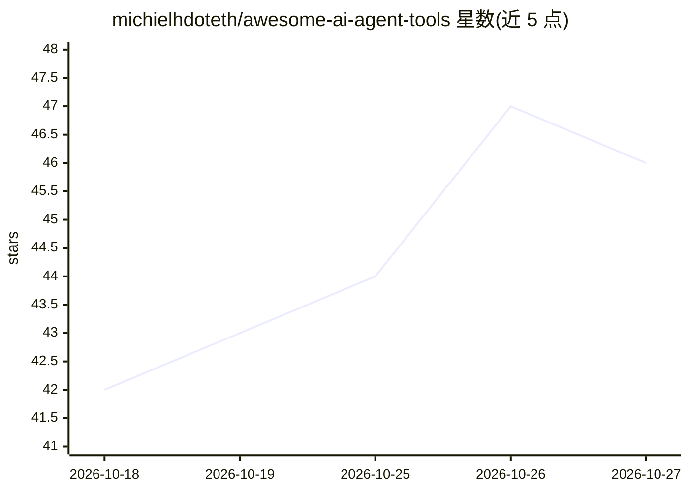

# michielhdoteth/awesome-ai-agent-tools

⭐ 46 · JavaScript · CC0-1.0 · 推送 2026-10-26 · [GitHub](https://github.com/michielhdoteth/awesome-ai-agent-tools) · [官网](https://awesome-ai-agent-tools.vercel.app) · 个人维护

**AI 编程助手可安装组件的策展清单（644 项，8 类）**

面向 AI 编程助手生态的聚合目录：收录 644 个来自真实开源项目的可安装组件，按 Skills、MCP servers、Agent Loops、Subagents、Hooks、Plugins、Prompts、Tools 八大类组织，各类目提供 catalog.json 机器可读目录与分类明细（如 97 个 skills 分 9 类、163 个 MCP servers 分 19 类）。条目声明兼容 Claude Code、Codex、Cursor、Gemini CLI、Copilot 等 30 余种 AI 编程助手。README 未提供本清单自身的安装命令。

## 筛选速览

| 维度 | 判定 | 备注 |
|---|---|---|
| AI 角色 | `ai-knowledge` | 知识聚合/清单类 |
| 许可风险 | `viral` | CC0-1.0 |
| 部署形态 | `None` |  |
| 模型依赖 | — | README 未给出锁定关系 |
| 硬件要求 | — | 无带数字的原话,不猜 |
| 安装摩擦 | `low` | 无编译、无系统依赖或容器化 |
| 成熟度 | — | 结构信号不足 |

## 能力要点

- 644 个可安装组件，均来源于真实开源项目
- 8 大类目，各类附 catalog.json 机器可读目录
- 声明兼容 Claude Code、Cursor、Codex、Gemini CLI 等 30+ 编程助手

## 适用场景

- 为我的编程助手查找技能、MCP server 或 subagent 组件
- 按类别浏览 agent 工作流与 hooks 生态
- 以 catalog.json 形式获取机器可读的组件目录

## 场景标签

`精选清单` · 领域:学习与行业

## 证据(README 行号)

> L8: Skills, MCP servers, agent workflows, subagents, hooks, plugins, prompts, and CLI tools for AI coding assistants.
> L10: **644** installable components across **8** categories. Every entry is sourced from a real open-source project. Wor

## 星数曲线

2026-10-18 42 → 2026-10-27 46（+4）

---
*卡片 v1 · prompt 1.4 · 生成 2026-10-25 · 置信度 high · 依据 README sha `8af969eb6df4` · [字段定义](../../DATASET.md)*
