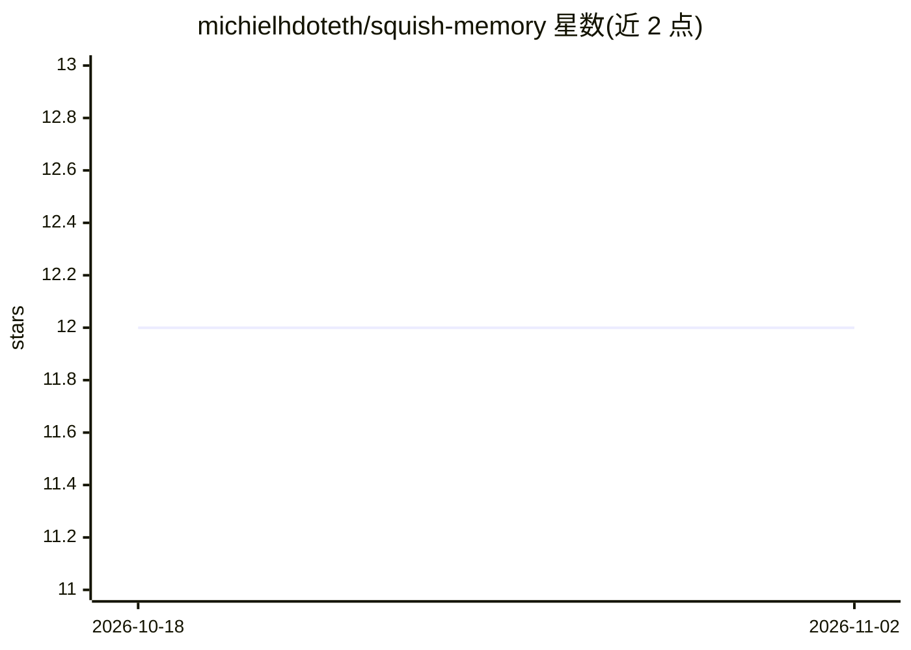

# michielhdoteth/squish-memory

⭐ 12 · TypeScript · NOASSERTION · 推送 2026-11-01 · [GitHub](https://github.com/michielhdoteth/squish-memory) · [官网](https://squishplugin.dev) · 个人维护

**为 AI agent 提供校准置信度记忆的本地运行时**

面向 AI 编码 agent 的记忆系统：后台捕获决策、约束与偏好，存入本地 SQLite 文件并做衰减评分；召回时仅注入相关上下文（50-200 tokens）。关键机制是校准召回置信度（自评 ECE 0.055）与诚实弃答——低于置信阈值时返回 NO CONFIDENT MATCH 而非最佳猜测，另支持时间有效性窗口查询历史状态。以单一 npm 包提供 CLI、MCP server 与桌面端三种接口，兼容 Claude Code、Cursor、Codex、OpenCode 等。限制：HTTP 模式明文传输、本地数据库无静态加密；付费项含 $99 桌面版与可选云积分。

## 筛选速览

| 维度 | 判定 | 备注 |
|---|---|---|
| AI 角色 | `ai-ecosystem` | LLM/agent 周边工具 |
| 许可风险 | `none` | NOASSERTION |
| 部署形态 | `library` | 以包/库形式分发 |
| 模型依赖 | — | README 未给出锁定关系 |
| 硬件要求 | — | 无带数字的原话,不猜 |
| 安装摩擦 | `low` | 无编译、无系统依赖或容器化 |
| 成熟度 | — | 结构信号不足 |

## 能力要点

- 校准召回置信度（ECE 0.055）与低于阈值时的 NO CONFIDENT MATCH 弃答
- 时间有效性窗口：按历史时点返回当时为真的记忆
- 单一 npm 包提供 CLI、MCP server 与桌面端三种接口
- 本地 SQLite 存储，无 Docker、无 API key、零配置

## 适用场景

- 给 Claude Code / Codex / Cursor 等编码 agent 挂上跨会话记忆
- 让 agent 在记忆不可靠时弃答而非编造
- 按时间点查询项目历史决策与约束

## 场景标签

`Agent 记忆` · 领域:Agent 开发

## 证据(README 行号)

> L7: Squish is the only memory runtime in this space that tells your agent how much each recollection deserves to be trus
> L34: - **squish mcp** — MCP server for any MCP-compatible agent
> L75:     squish-mcp (MCP server)

## 星数曲线

2026-10-18 12 → 2026-11-02 12（+0）

---
*卡片 v1 · prompt 1.4 · 生成 2026-11-01 · 置信度 high · 依据 README sha `e9b1c82188ca` · [字段定义](../../DATASET.md)*
