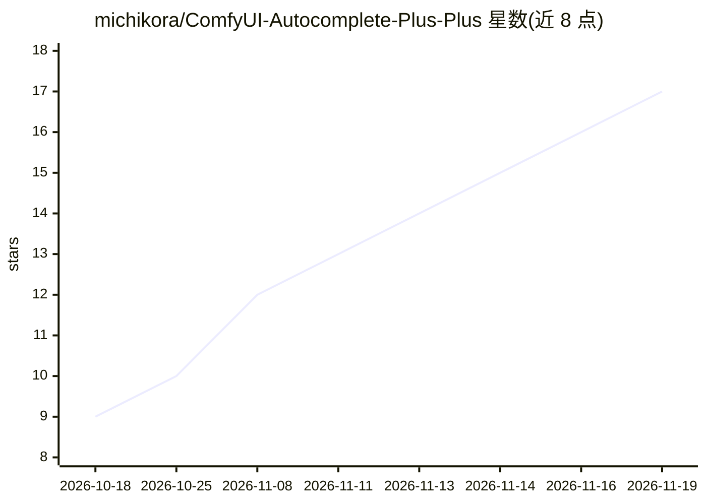

# michikora/ComfyUI-Autocomplete-Plus-Plus

⭐ 17 · JavaScript · MIT · 推送 2026-09-15 · [GitHub](https://github.com/michikora/ComfyUI-Autocomplete-Plus-Plus) · 个人维护 · 中文 README

**ComfyUI 提示词输入的自动补全与动态扩展扩展**

ComfyUI 自定义节点扩展：为文本输入框提供 Danbooru/e621 标签补全（含别名与翻译）、LoRA/embedding 建议、通配符与动态提示词展开（Follow Seed/Keep Last Choice/Sequential 三种采样模式）、提示词自动格式化、权重调整与标签换位等编辑快捷键，以及标签使用频率收藏。可通过 ComfyUI-Manager 或手动克隆到 custom_nodes 目录安装，支持 ComfyUI Node 2.0 与经典 LiteGraph UI，可与 ComfyUI-Lora-Manager 集成。项目由 ComfyUI-Autocomplete-Plus 重构而来。

## 筛选速览

| 维度 | 判定 | 备注 |
|---|---|---|
| AI 角色 | `ai-ecosystem` | LLM/agent 周边工具 |
| 许可风险 | `permissive` | MIT |
| 部署形态 | `None` |  |
| 模型依赖 | — | README 未给出锁定关系 |
| 硬件要求 | — | 无带数字的原话,不猜 |
| 安装摩擦 | `low` | 无编译、无系统依赖或容器化 |
| 成熟度 | `idea` | |

## 能力要点

- Danbooru/e621 标签、别名与翻译实时补全，含类别颜色与 wiki 链接
- 动态提示词与通配符展开：Follow Seed、Keep Last Choice、Sequential 三种模式，多 pass 保持一致采样
- Ctrl+Up/Down 标签与 LoRA 权重调整、逐标签光标导航与标签换位
- PNG 导入时恢复动态提示词选择（实验性）

## 适用场景

- 在 ComfyUI 中快速输入和查找 Danbooru/e621 标签
- 用通配符和动态提示词语法批量生成可复现的提示词组合
- 细粒度调整 LoRA/嵌入权重并管理常用标签

## 场景标签

`提示工程` · 领域:Agent 开发

## 证据(README 行号)

> L5: Tag autocomplete, prompt formatting, and dynamic prompt expansion extension for ComfyUI.
> L11: **Autocomplete++** provides tag autocomplete, LoRA/embedding suggestions, dynamic prompt and wildcard expansion, au

## 星数曲线

2026-10-18 9 → 2026-11-19 17（+8）

---
*卡片 v1 · prompt 1.4 · 生成 2026-11-18 · 置信度 high · 依据 README sha `beede1a1e3dd` · [字段定义](../../DATASET.md)*
