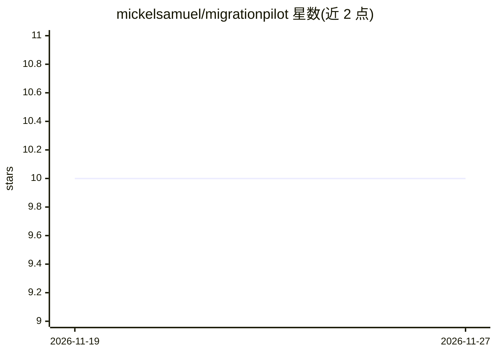

# mickelsamuel/migrationpilot

⭐ 10 · TypeScript · MIT · 推送 2026-11-18 · [GitHub](https://github.com/mickelsamuel/migrationpilot) · [官网](https://migrationpilot.dev) · 个人维护

**给开发者拦截不安全 PostgreSQL 迁移的 CLI linter**

本地、确定性的 PostgreSQL 迁移检查工具：内置编译好的 PostgreSQL 解析器，按 112 条规则分析迁移 SQL，结合锁分析给出风险评分，CI 中以非零退出码阻断危险变更。提供 24 个子命令（auto-fix、目录级序列分析、PGlite 模拟执行、回滚 DDL 等），自动识别 14 种迁移框架。通过 npm/brew/docker/单文件可执行文件分发，另提供 GitHub Action、GitLab CI、pre-commit 集成与面向 AI 编码代理的 MCP server 和 Claude Code 插件。Org 计划许可键启用策略块与审计日志。

## 筛选速览

| 维度 | 判定 | 备注 |
|---|---|---|
| AI 角色 | `ai-enhanced` | 去掉 AI 部分产品仍成立 |
| 许可风险 | `permissive` | MIT |
| 部署形态 | `desktop` | 安装包/桌面程序 |
| 模型依赖 | locked-api |  |
| 硬件要求 | — | 无带数字的原话,不猜 |
| 安装摩擦 | `low` | 无编译、无系统依赖或容器化 |
| 成熟度 | — | 结构信号不足 |

## 能力要点

- 内置 PostgreSQL 解析器与 112 条规则（34 critical，20 条可 --fix）
- 跨文件序列分析：累计锁预算与热点表多次触碰检测
- MCP server 提供 7 个工具，含 check_before_apply 门禁
- simulate 用 PGlite 对迁移做进程内实际执行

## 适用场景

- 在 PR 合并前拦截会长时间锁表的 DDL 变更
- 给 AI 编码代理加一道写迁移前的检查门禁
- 自动检测 Flyway/Django/Prisma 等框架的迁移并按序分析
- 为无一行修复的违规生成 expand-contract 分步计划

## 场景标签

`代码审查` · 领域:编码与开发

## 证据(README 行号)

> L10: **Block unsafe Postgres migrations before merge.**
> L76: **MCP server.** Seven tools, the important one being `check_before_apply`: a pass/fail gate the agent calls before 

## 星数曲线

2026-11-19 10 → 2026-11-27 10（+0）

---
*卡片 v1 · prompt 1.4 · 生成 2026-11-19 · 置信度 high · 依据 README sha `831d68243b21` · [字段定义](../../DATASET.md)*
