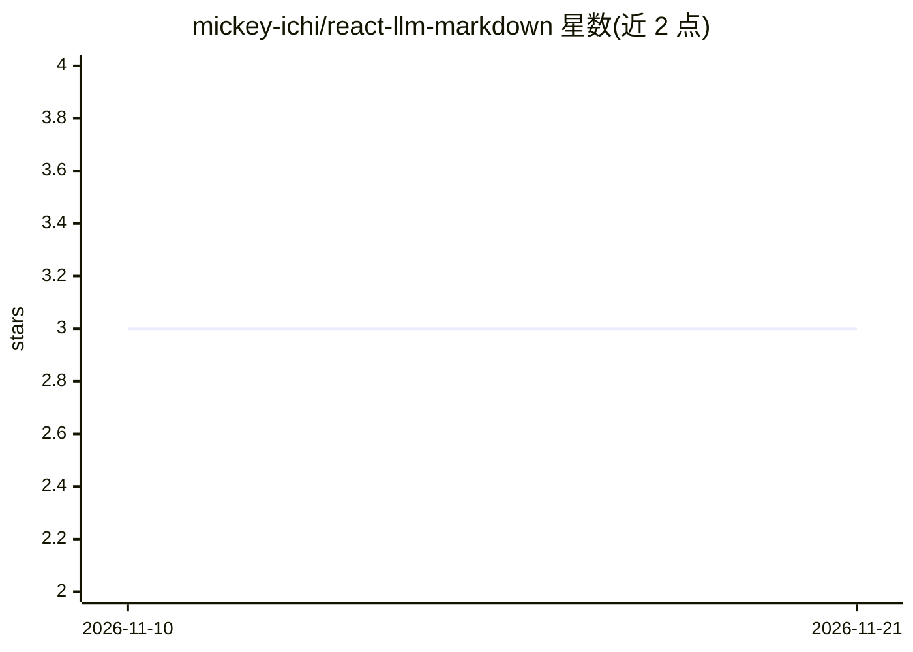

# mickey-ichi/react-llm-markdown

⭐ 3 · TypeScript · MIT · 推送 2026-11-07 · [GitHub](https://github.com/mickey-ichi/react-llm-markdown) · [官网](https://mickey-ichi.github.io/react-llm-markdown/) · 个人维护

**为 LLM 输出打造的安全 Markdown React/React Native 渲染组件**

一个 React 与 React Native 通用组件，将 LLM 生成的 Markdown 渲染为富内容：GFM 表格、Shiki 代码高亮、KaTeX 公式、Mermaid 图与 ECharts 图表，流式输出时自动修复未完成的 Markdown 片段。默认按不可信输入处理：HTML 净化、URL 白名单、DOM 破坏防护、图表选项白名单与限制，并用 27 个攻击载荷做浏览器端测试。提供预构建 CSS、明暗主题、SSR 与按需插件，附带 npx 启动的 Markdown 实时预览 CLI。React 支持 18/19，React Native 0.74+，Node.js 20+。

## 筛选速览

| 维度 | 判定 | 备注 |
|---|---|---|
| AI 角色 | `ai-ecosystem` | LLM/agent 周边工具 |
| 许可风险 | `permissive` | MIT |
| 部署形态 | `library` | 以包/库形式分发 |
| 模型依赖 | — | README 未给出锁定关系 |
| 硬件要求 | — | 无带数字的原话,不猜 |
| 安装摩擦 | `low` | 无编译、无系统依赖或容器化 |
| 成熟度 | — | 结构信号不足 |

## 能力要点

- 流式渲染时修复半成品表格/代码块/强调标记
- 安全硬化：HTML 净化、URL 与图表选项白名单、DOM-clobbering 防护
- 同一包同时支持 Web 与 React Native（Expo Go 兼容），图表在沙箱 WebView 中渲染
- npx CLI 可在浏览器中实时预览任意 Markdown 文件

## 适用场景

- 聊天界面中流式渲染模型的 Markdown 回答
- 在 React Native 应用中安全展示 LLM 输出含公式/图表的内容
- 本地快速预览 Markdown 文件

## 场景标签

 · 领域:前端开发/LLM 应用组件

## 证据(README 行号)

> L3: **Safe, rich Markdown for React and React Native — built for text an LLM wrote.**
> L32: the rich blocks models use, repairs Markdown as it streams, and neutralizes the rest, on the web and in React Nativ
> L41: - **Web and React Native** — one package, one parser and one set of security rules; native views on the phone, with

## 星数曲线

2026-11-10 3 → 2026-11-21 3（+0）

---
*卡片 v1 · prompt 1.4 · 生成 2026-11-21 · 置信度 high · 依据 README sha `fedfcf107917` · [字段定义](../../DATASET.md)*
