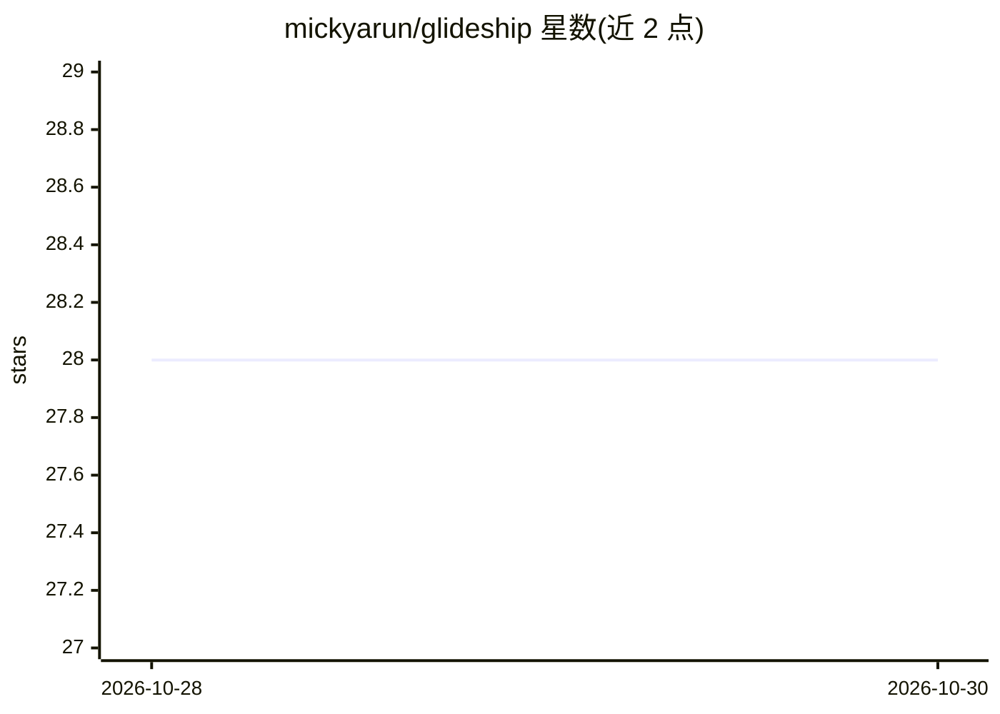

# mickyarun/glideship

⭐ 28 · Python · Apache-2.0 · 推送 2026-10-29 · [GitHub](https://github.com/mickyarun/glideship) · [官网](https://glideship.ai/) · 个人维护

**面向 AI 原生团队的自主托管项目管理平台，替代 Jira/Scrum**

自托管的软件交付全生命周期管理平台（原名 Bodhiorchard），以 Agent-Driven Development 取代 Scrum 流程：12 个专门化 AI agent 负责 Slack 入口分诊、BUD 规格文档起草、技术计划、测试计划、站会摘要与回顾，人工在各阶段间做决策门控。提供 P50/P70/P85 概率化交付日期预测（AI-PERT + 万次蒙特卡洛模拟），并以 XP 激励实际发布的工作；另含 HR 请假/员工记录工作区。推理通过外部 agent 运行时（Claude Code、GitHub Copilot、OpenAI Codex 或 Ollama 本地推理）按组织选择。

## 筛选速览

| 维度 | 判定 | 备注 |
|---|---|---|
| AI 角色 | `ai-native` | 本体是模型或模型工具 |
| 许可风险 | `permissive` | Apache-2.0 |
| 部署形态 | `self-host` | docker 或自建部署 |
| 模型依赖 | local-ok | 支持本地模型 |
| 硬件要求 | — | 无带数字的原话,不猜 |
| 安装摩擦 | `low` | 无编译、无系统依赖或容器化 |
| 成熟度 | — | 结构信号不足 |

## 能力要点

- 12 个专门化 agent 覆盖 intake 到回顾的完整生命周期
- AI-PERT + 10,000 次蒙特卡洛模拟输出分位数交付日期
- tree-sitter 多仓库代码图谱与向量检索知识库
- 支持 Jira issue 导入；HR 敏感字段 AES-256-GCM 加密

## 适用场景

- 团队用 Slack 消息发起需求并由 agent 分诊、起草规格
- 替换 Jira/Scrum 仪式，用概率预测取代故事点
- 自托管保留数据，配合本地 Ollama 做完全本地推理

## 场景标签

`多智能体` · 领域:Agent 开发

## 证据(README 行号)

> L21: **Glideship** replaces sprint, scrum, and Jira ceremony with **Agent-Driven Development (ADD)** — twelve specialise
> L57: |🤖 **AI drafts, you decide**|Agents write the specs, tech plans, and test cases. Humans review, edit, and approve a
> L146: ## The Twelve Agents

## 星数曲线

2026-10-28 28 → 2026-10-30 28（+0）

---
*卡片 v1 · prompt 1.4 · 生成 2026-10-28 · 置信度 high · 依据 README sha `0377309ce883` · [字段定义](../../DATASET.md)*
