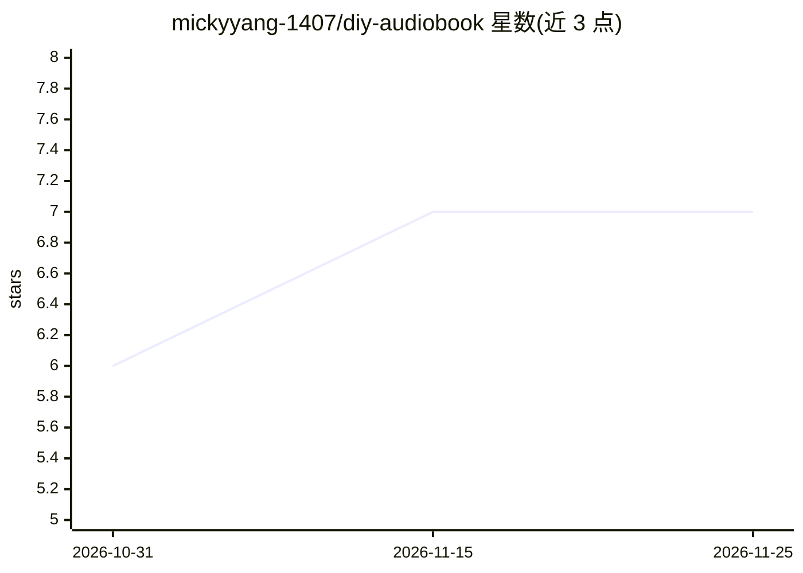

# mickyyang-1407/diy-audiobook

⭐ 7 · Python · MIT · 推送 2026-10-29 · [GitHub](https://github.com/mickyyang-1407/diy-audiobook) · [官网](https://mickyyang-1407.github.io/diy-audiobook/) · 个人维护 · 中文 README

**Claude Code 技能：一句话生成多角色有声书/广播剧**

以 Claude Code 技能形式分发的内容生产流水线：输入一个故事文本后，由 Claude 改写为可听版本、为每个角色分配声音、生成图片与音乐提示词，再由确定性脚本负责引号统计、段落对齐、响度测量、静音裁剪、配乐闪避与质检，最终输出 m4a 音频、mp4 视频、封面、字幕、章节与简介文本。免费路径使用 Microsoft Edge 声音与内置音乐盒摇篮曲，无需账号与 API key；付费路径接入 MiniMax、OpenAI、Suno 或本地 ComfyUI。要求 Claude Code、Python 3.9+ 与 ffmpeg。

## 筛选速览

| 维度 | 判定 | 备注 |
|---|---|---|
| AI 角色 | `ai-native` | 本体是模型或模型工具 |
| 许可风险 | `permissive` | MIT |
| 部署形态 | `library` | 以包/库形式分发 |
| 模型依赖 | — | README 未给出锁定关系 |
| 硬件要求 | — | 无带数字的原话,不猜 |
| 安装摩擦 | `medium` | 含编译或系统依赖之一 |
| 成熟度 | — | 结构信号不足 |

## 能力要点

- Claude 负责改编/选角/提示词，脚本负责对齐、响度、剪辑等确定性步骤
- 免费声音与音乐开箱即用，无需账号与 API key
- check.py 质检通过前不上传任何付费服务
- 每步均为独立脚本，可不依赖 Claude Code 单独运行

## 适用场景

- 给孩子制作带插图和配乐的中文睡前故事
- 把公版小说做成多角色有声书并导出字幕章节
- 为播客/频道批量产出广播剧节目

## 场景标签

`语音合成` `图像生成` `AI 写作` · 领域:内容生成

## 证据(README 行号)

> L3: **Make your own audiobook, children's story or bedtime radio drama — every character with their own voice,
> L75:  story ──▶ fetch ──▶ Claude adapts ──▶ Claude casts ──▶ check ──▶ synth ──▶ mix ──▶ video ──▶ qc ──▶ package
> L83: glitches. Nothing reaches a paid service until `check.py` passes.

## 星数曲线

2026-10-31 6 → 2026-11-25 7（+1）

---
*卡片 v1 · prompt 1.4 · 生成 2026-11-21 · 置信度 mid · 依据 README sha `35dac8700be7` · [字段定义](../../DATASET.md)*
