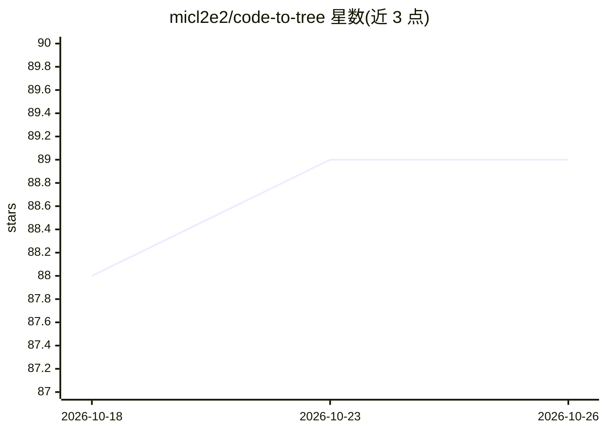

# micl2e2/code-to-tree

⭐ 89 · C · MIT · 推送 2026-03-14 · [GitHub](https://github.com/micl2e2/code-to-tree) · 个人维护

**把源代码转成 AST 的 MCP 服务器，单二进制无运行时依赖**

面向 MCP 客户端（以 Claude 为例）的 code-to-tree 服务器：基于 tree-sitter 将 C、C++、Rust、Ruby、Go、Java、Python 七种语言的源代码转换为抽象语法树（AST），供 LLM 使用。以单一独立二进制交付，底层用 mcpc 实现，无运行时依赖。安装途径为 GitHub release 页下载预编译可执行文件，或自行编译：需 MSYS2/Xcode 环境下先编译安装 tree-sitter 及各语言 grammar，再安装 mcpc 后构建。README 提示 LLM 对同一问题的输出可能不同。

## 筛选速览

| 维度 | 判定 | 备注 |
|---|---|---|
| AI 角色 | `ai-ecosystem` | LLM/agent 周边工具 |
| 许可风险 | `permissive` | MIT |
| 部署形态 | `desktop` | 安装包/桌面程序 |
| 模型依赖 | — | README 未给出锁定关系 |
| 硬件要求 | — | 无带数字的原话,不猜 |
| 安装摩擦 | `medium` | 含编译或系统依赖之一 |
| 成熟度 | — | 结构信号不足 |

## 能力要点

- tree-sitter 支持 C/C++/Rust/Ruby/Go/Java/Python 七种语言的 AST 转换
- 单独立二进制即 MCP 客户端所需的全部
- 无运行时依赖，最小化终端用户机器上的软件依赖

## 适用场景

- 让 Claude 等 MCP 客户端准确解析多语言源代码的语法结构
- 代码分析场景中为 LLM 提供语言无关的 AST 能力

## 场景标签

 · 领域:开发工具/LLM 基础设施

## 证据(README 行号)

> L7: 1. Give LLMs the capability of **accurately** converting source code into
> L14:  choose tree-sitter, and languages are: C, C++, Rust, Ruby, Go, Java, Python.
> L42: Here we use Claude as the example.

## 星数曲线

2026-10-18 88 → 2026-10-26 89（+1）

---
*卡片 v1 · prompt 1.4 · 生成 2026-10-24 · 置信度 high · 依据 README sha `0845ddf8b336` · [字段定义](../../DATASET.md)*
