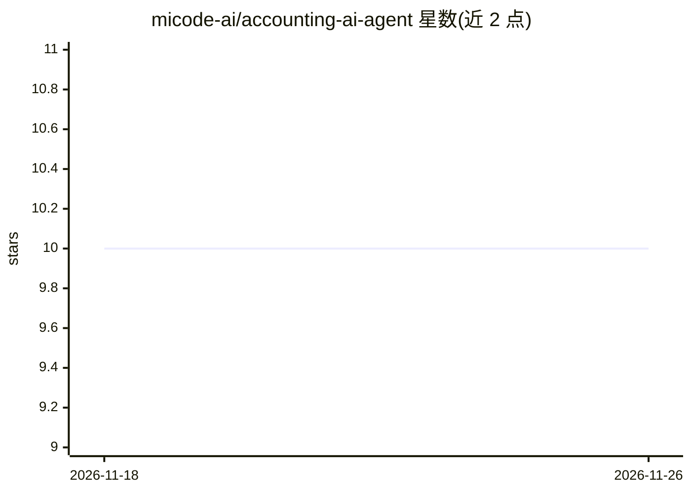

# micode-ai/accounting-ai-agent

⭐ 10 · TypeScript · MIT · 推送 2026-11-02 · [GitHub](https://github.com/micode-ai/accounting-ai-agent) · [官网](https://eksiegowyai.pl) · 组织维护

**面向波兰中小企业的 AI 会计与记账 Agent**

基于 LangGraph 的会计自动化 Agent，针对波兰中小企业（SMB）场景：提供 80+ 领域工具，接入 wFirma 会计系统、KSeF 电子发票（FA-3 格式）、e-Doręczenia 收件箱监听，并内置法定税务日历与截止日期主动提醒。技术形态为 TypeScript monorepo：Next.js 15 前端 + Express/Prisma API 后端、Telegram bot、语音对话及 Stripe 订阅计费。安装依赖 Node.js ≥18、Docker/Docker Compose 与 npm ≥9，支持脚本自动化或手动初始化。

## 筛选速览

| 维度 | 判定 | 备注 |
|---|---|---|
| AI 角色 | `ai-native` | 本体是模型或模型工具 |
| 许可风险 | `permissive` | MIT |
| 部署形态 | `self-host` | docker 或自建部署 |
| 模型依赖 | — | README 未给出锁定关系 |
| 硬件要求 | — | 无带数字的原话,不猜 |
| 安装摩擦 | `low` | 无编译、无系统依赖或容器化 |
| 成熟度 | — | 结构信号不足 |

## 能力要点

- LangGraph 多 Agent 架构与 80+ 会计领域工具
- KSeF 电子发票（FA-3）与 wFirma 会计系统集成
- 税务日历主动提醒与 e-Doręceries 收件箱监听
- Telegram bot 与语音对话入口，Stripe 订阅计费

## 适用场景

- 为波兰中小企业自动化记账与财务报表生成
- 处理 KSeF 合规电子发票的开具与管理
- 通过 Telegram 或网页对话完成日常会计操作
- 跟踪法定税务截止日期避免逾期申报

## 场景标签

`工作流自动化` · 领域:效率与自动化

## 证据(README 行号)

> L3: AI-powered accounting agent for automation of bookkeeping and financial reporting.
> L166: - AI Agents - LangGraph multi-agent system

## 星数曲线

2026-11-18 10 → 2026-11-26 10（+0）

---
*卡片 v1 · prompt 1.4 · 生成 2026-11-19 · 置信度 mid · 依据 README sha `65df56e7339f` · [字段定义](../../DATASET.md)*
