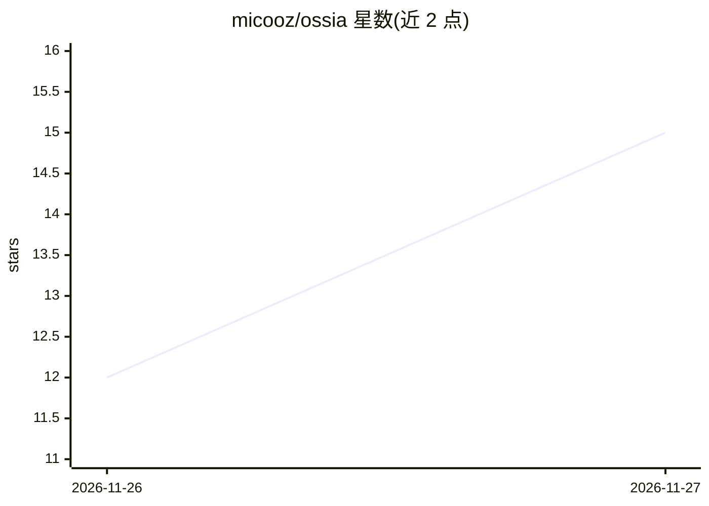

# micooz/ossia

⭐ 15 · Rust · GPL-3.0 · 推送 2026-11-26 · [GitHub](https://github.com/micooz/ossia) · [官网](http://ossia.apporz.com) · 组织维护 · 中文 README

**通过 AI agent 对话创建和编辑乐谱的记谱软件**

Ossia 是一款桌面乐谱软件，通过内置服务与 AI agent 连接，用户在对话中以 $ossia 或 /ossia 指令创建、编排、导入、转置和导出乐谱。支持钢琴、吉他、尤克里里、小提琴等乐器的制谱，可导入 MusicXML、MIDI、PDF 和乐谱图片，导出 PDF、PNG、SVG、MIDI、WAV。乐谱库、版本历史本地存储；可选配置 OMR 服务用于乐谱识别。提供 macOS（Apple Silicon）与 Windows x64 安装包，安装包未签名。

## 筛选速览

| 维度 | 判定 | 备注 |
|---|---|---|
| AI 角色 | `ai-enhanced` | 去掉 AI 部分产品仍成立 |
| 许可风险 | `viral` | GPL-3.0 |
| 部署形态 | `None` |  |
| 模型依赖 | locked-api |  |
| 硬件要求 | — | 无带数字的原话,不猜 |
| 安装摩擦 | `low` | 无编译、无系统依赖或容器化 |
| 成熟度 | — | 结构信号不足 |

## 能力要点

- 通过 agent 对话制谱、编曲、分析和移调
- 导入 MusicXML、MIDI、PDF 与乐谱图片，导出 PDF/PNG/SVG/MIDI/WAV
- 乐谱库、原件与版本历史本地存储（~/.ossia）
- 可选 OMR 乐谱识别服务，支持自托管

## 适用场景

- 教学或学习中快速生成和改编练习曲与乐曲
- 把 PDF 或图片里的乐谱转成可编辑的乐谱文件
- 为吉他编写带和弦图的 tab 谱

## 场景标签

`文档解析` · 领域:知识与检索

## 证据(README 行号)

> L11: Ossia is AI-native music notation software that gives AI agents the tools and guidance they need to create scores t
> L21: Ossia connects to popular AI agents (see Connect an agent for the full list). It also lets you:
> L24: - Import MusicXML, MIDI, PDF, and images of scores, with help from an Ossia OMR service where appropriate.

## 星数曲线

2026-11-26 12 → 2026-11-27 15（+3）

---
*卡片 v1 · prompt 1.4 · 生成 2026-11-26 · 置信度 high · 依据 README sha `05ad19f01609` · [字段定义](../../DATASET.md)*
