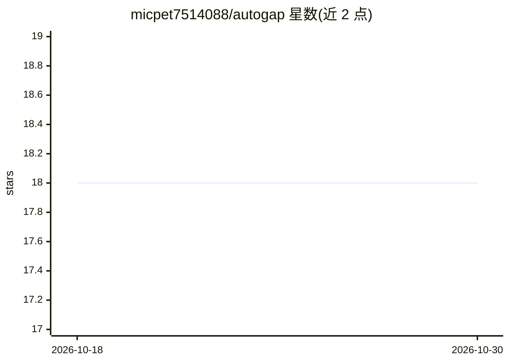

# micpet7514088/autogap

⭐ 18 · PowerShell · MIT · 推送 2026-04-23 · [GitHub](https://github.com/micpet7514088/autogap) · [官网](https://github.com/micpet7514088/autogap) · 组织维护

**Claude Code 技能：诊断任意项目的前 3 大缺口并可代为执行修复**

以 Claude Code skill（SKILL.md）形式交付的项目诊断工具：给定项目目录后，从文件信号分类项目类型（代码、文档、战略、创作、运维等），推断项目的首要目标，报告阻碍该目标的 3 个最大缺口与 3 个宏观步骤，随后呈现编号菜单等待用户选择；选定后自主规划、执行、验证并汇报变更。适用于不限于软件的各类项目。通过 curl 安装脚本或 git clone 安装，附三个带预期输出的示例项目。

## 筛选速览

| 维度 | 判定 | 备注 |
|---|---|---|
| AI 角色 | `ai-native` | 本体是模型或模型工具 |
| 许可风险 | `permissive` | MIT |
| 部署形态 | `library` | 以包/库形式分发 |
| 模型依赖 | — | README 未给出锁定关系 |
| 硬件要求 | — | 无带数字的原话,不猜 |
| 安装摩擦 | `low` | 无编译、无系统依赖或容器化 |
| 成熟度 | — | 结构信号不足 |

## 能力要点

- 从文件信号分类项目类型，不预设项目为软件
- 输出恰好 3 个按阻碍强度排序的缺口与 3 个宏观步骤
- 菜单式选择后自主执行并验证，歧义不可逆操作时停止
- 附 3 个覆盖代码/文档/战略类型的示例项目及预期输出

## 适用场景

- 诊断代码仓库或 monorepo 的关键缺口
- 分析研究笔记、规格文档等文档型项目
- 审视产品路线图、OKR 等战略材料并获取改进步骤

## 场景标签

`编码 Agent` · 领域:编码与开发

## 证据(README 行号)

> L3: > **The first Claude Code skill that diagnoses the top 3 gaps in any project — code or not.**
> L5: Give `autogap` a project directory. It classifies the project type from file signals (not assumptions), infers the t

## 星数曲线

2026-10-18 18 → 2026-10-30 18（+0）

---
*卡片 v1 · prompt 1.4 · 生成 2026-10-29 · 置信度 mid · 依据 README sha `c3d53c532b4d` · [字段定义](../../DATASET.md)*
