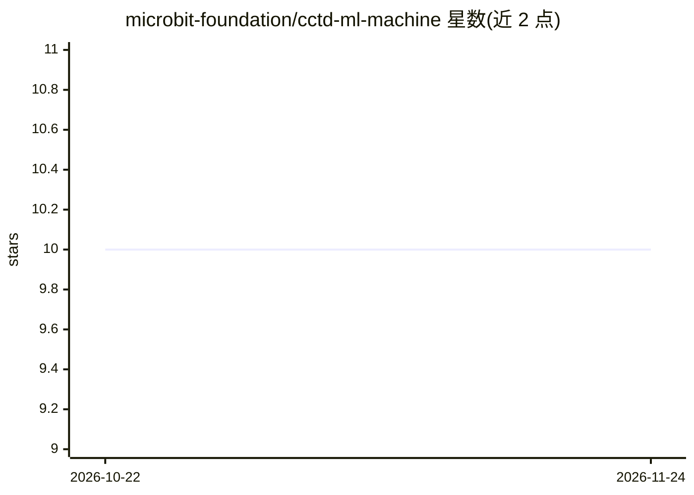

# microbit-foundation/cctd-ml-machine

⭐ 10 · TypeScript · MIT · 推送 2026-09-24 · [GitHub](https://github.com/microbit-foundation/cctd-ml-machine) · [官网](https://ml-machine.org/) · 组织维护

**面向教育的交互式机器学习平台：micro:bit 手势识别与反馈**

奥胡斯大学计算思维与设计中心开发的开源交互式机器学习平台，通过蓝牙连接 micro:bit 传感器板录制手势样本，训练模型识别用户手势，识别后触发声音、LED 或 I/O 引脚反馈动作。支持创建多个手势标签、逐类录制示例、训练预测模型，并可配置置信度阈值（默认 80%）。提供 ML-Machine.org 在线版，本地可通过 npm 或 Docker 运行；固件以 hex 文件形式由应用自动上传至 micro:bit。

## 筛选速览

| 维度 | 判定 | 备注 |
|---|---|---|
| AI 角色 | `ai-native` | 本体是模型或模型工具 |
| 许可风险 | `permissive` | MIT |
| 部署形态 | `self-host` | docker 或自建部署 |
| 模型依赖 | — | README 未给出锁定关系 |
| 硬件要求 | — | 无带数字的原话,不猜 |
| 安装摩擦 | `low` | 无编译、无系统依赖或容器化 |
| 成熟度 | — | 结构信号不足 |

## 能力要点

- 通过 micro:bit 蓝牙录制手势样本并训练识别模型
- 识别触发声音、LED 显示或 I/O 引脚反馈动作
- 可配置每个手势的置信度阈值，实时置信度显示
- 平台可经 USB 自动上传固件到 micro:bit，无需手动刷 hex

## 适用场景

- 课堂上让学生录制手势并训练模型体验机器学习流程
- 用 micro:bit 做手势控制的互动装置或电路实验
- 在浏览器访问 ML-Machine.org 免安装使用

## 场景标签

`目标检测` · 领域:感知与多模态

## 证据(README 行号)

> L3: ML-Machine is a free and open-source interactive machine-learning platform, utilising external sensors to generate d
> L155: - TensorFlow.js provides machine learning capabilities.
> L174: ML-Machine is a platform created by the Center for Computational Thinking and Design (see CCTD.dk) at Aarhus Unive

## 星数曲线

2026-10-22 10 → 2026-11-24 10（+0）

---
*卡片 v1 · prompt 1.4 · 生成 2026-11-19 · 置信度 high · 依据 README sha `830924bcfa8c` · [字段定义](../../DATASET.md)*
