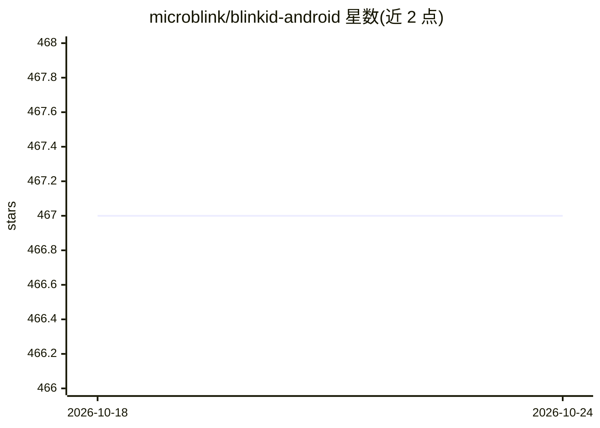

# microblink/blinkid-android

⭐ 467 · Kotlin · NOASSERTION · 推送 2026-10-08 · [GitHub](https://github.com/microblink/blinkid-android) · [官网](http://microblink.github.io/blinkid-android/) · 组织维护

**面向 Android 原生应用的 AI 证件扫描与数据提取 SDK**

Microblink 公司提供的 Android 证件扫描 SDK：通过相机扫描各类身份证件，从条形码、MRZ 和视觉区三个数据源提取字段，按可靠性合并为通用结果并分侧分区输出。以 Maven Central 依赖形式集成，需申请与应用 ID 绑定的许可证密钥；支持 Jetpack Compose composable 与 Activity 两种接入方式，附带三个示例工程。机器学习资源可下载、预打包或 OTA 更新。要求 Android API 24+、相机预览分辨率至少 1080p，原生库仅编译 ARMv7 与 ARM64 架构。

## 筛选速览

| 维度 | 判定 | 备注 |
|---|---|---|
| AI 角色 | `ai-native` | 本体是模型或模型工具 |
| 许可风险 | `none` | NOASSERTION |
| 部署形态 | `None` |  |
| 模型依赖 | — | README 未给出锁定关系 |
| 硬件要求 | — | 无带数字的原话,不猜 |
| 安装摩擦 | `low` | 无编译、无系统依赖或容器化 |
| 成熟度 | — | 结构信号不足 |

## 能力要点

- 从 Barcode/MRZ/视觉区三数据源提取证件字段，按可靠性合并输出
- 支持 Jetpack Compose composable 与 BlinkIdScanActivity 两种集成路径
- 机器学习资源支持预打包、下载与 OTA 更新两种配置
- 提供 Compose、Direct API 与 Java 三个示例应用

## 适用场景

- 在我的 Android 应用里加证件扫描与信息录入
- 构建 KYC/身份验证流程中的证件数据采集环节
- 读取护照 MRZ 与条形码数据并做多数据源交叉核对

## 场景标签

`OCR` `文档解析` · 领域:知识与检索

## 证据(README 行号)

> L5: The _BlinkID_ Android SDK is a comprehensive solution for implementing secure document scanning and extraction. It o
> L79: After the document scanning session is finished, the SDK returns an object of type BlinkIdScanningResult.

## 星数曲线

2026-10-18 467 → 2026-10-24 467（+0）

---
*卡片 v1 · prompt 1.4 · 生成 2026-10-21 · 置信度 high · 依据 README sha `affa6763eaef` · [字段定义](../../DATASET.md)*
