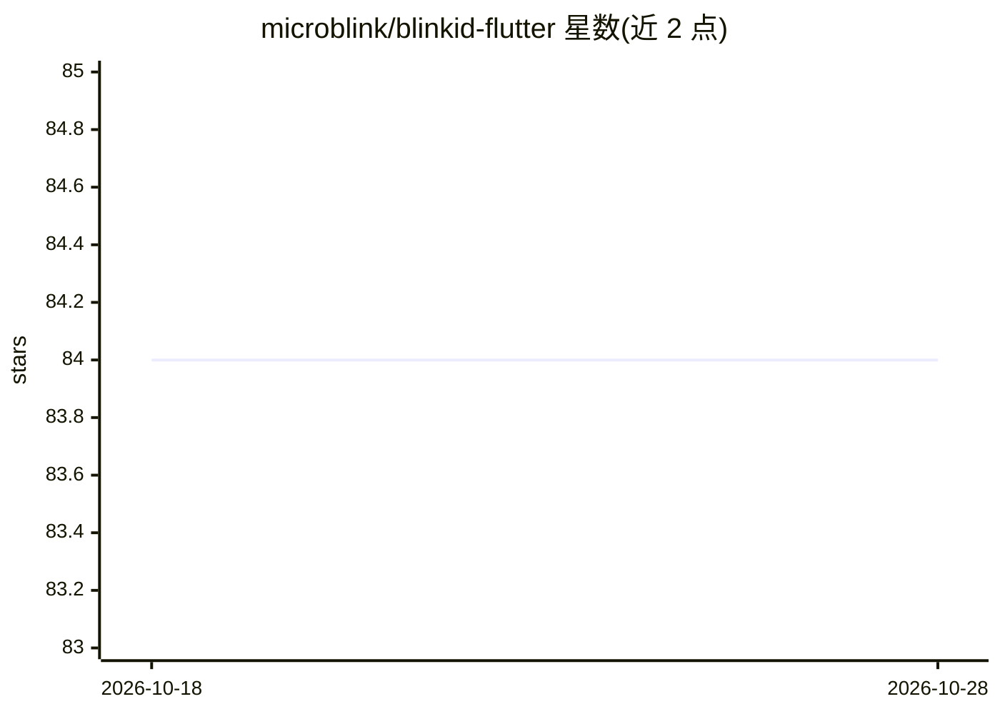

# microblink/blinkid-flutter

⭐ 84 · Dart · 推送 2026-09-09 · [GitHub](https://github.com/microblink/blinkid-flutter) · 组织维护

**面向 Flutter 应用开发者的证件扫描识别插件**

Microblink 商业 BlinkID SDK 的 Flutter 封装插件：通过摄像头或静态图片（DirectAPI）扫描各类身份证件，提供四个可配置模块——文档拍摄（检测/裁剪/模糊眩光倾斜检测/人脸提取）、MRZ 解析（护照/签证/身份证）、1D/2D 条码解析（PDF417、QR 等）、VIZ 字段提取与字符校验。初始化需在 Microblink 开发者中心注册获取许可证密钥（可申请免费试用）。原生 SDK 需 iOS 16+、Android API 24+、1080p 摄像头；封装层开源，性能上官方建议使用原生 SDK。

## 筛选速览

| 维度 | 判定 | 备注 |
|---|---|---|
| AI 角色 | `ai-native` | 本体是模型或模型工具 |
| 许可风险 | `none` | — |
| 部署形态 | `None` |  |
| 模型依赖 | — | README 未给出锁定关系 |
| 硬件要求 | — | 无带数字的原话,不猜 |
| 安装摩擦 | `low` | 无编译、无系统依赖或容器化 |
| 成熟度 | — | 结构信号不足 |

## 能力要点

- 四个独立扫描模块（Document Capture / MRZ / Barcode / VIZ）可自由组合启停
- performScan 摄像头扫描与 performDirectApiScan 静态图片 Base64 提取两种方式
- 支持按文档类别过滤（classFilter）与结果脱敏（redaction）
- 图像质量控制：模糊/眩光/倾斜灵敏度分级与坏帧拒绝策略

## 适用场景

- 在 Flutter 应用中集成 KYC 实名认证的证件信息采集
- 扫描护照/身份证提取 MRZ 与可视区字段
- 从相册静态图片批量提取证件数据

## 场景标签

`OCR` `文档解析` · 领域:知识与检索

## 证据(README 行号)

> L5: The BlinkID SDK is a comprehensive solution for implementing secure document scanning on the Flutter cross-platform.
> L197: |Module|Class|Purpose|
> L199: |**Document Capture**|`DocumentCaptureModuleSettings`|Document detection, cropping, image quality checks (blur, gl

## 星数曲线

2026-10-18 84 → 2026-10-28 84（+0）

---
*卡片 v1 · prompt 1.4 · 生成 2026-10-24 · 置信度 high · 依据 README sha `ffb36e363384` · [字段定义](../../DATASET.md)*
