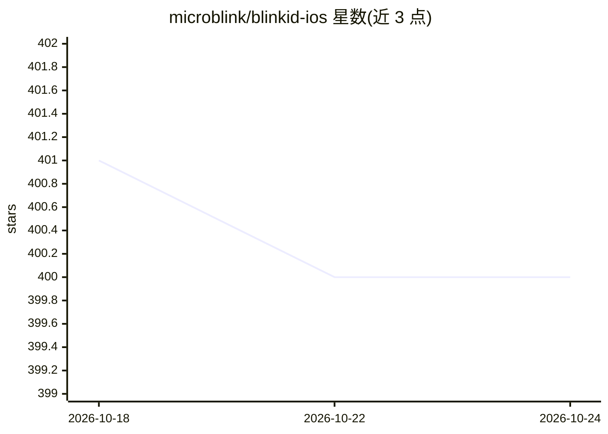

# microblink/blinkid-ios

⭐ 400 · Swift · 推送 2026-10-23 · [GitHub](https://github.com/microblink/blinkid-ios) · [官网](http://microblink.github.io/blinkid-ios/) · 组织维护

**iOS 开发者的 AI 证件扫描 SDK：识别多种身份证件**

Microblink 维护的 iOS 原生证件扫描 SDK，含核心 BlinkID 框架与可选的 BlinkIDUX SwiftUI 界面包。开发者初始化 SDK（需 license key）、创建扫描会话、逐帧处理相机图像并提取证件识别结果；支持逐帧完整度检查、服务端或客户端验证、取消处理等会话管理。通过 Swift Package Manager、手动集成 xcframework 或 git submodule 三种方式集成，最低要求 iOS 15.0+ / Swift 6.1，另提供面向 AI 编程助手的技能包以生成集成代码。

## 筛选速览

| 维度 | 判定 | 备注 |
|---|---|---|
| AI 角色 | `ai-native` | 本体是模型或模型工具 |
| 许可风险 | `none` | — |
| 部署形态 | `desktop` | 安装包/桌面程序 |
| 模型依赖 | — | README 未给出锁定关系 |
| 硬件要求 | — | 无带数字的原话,不猜 |
| 安装摩擦 | `low` | 无编译、无系统依赖或容器化 |
| 成熟度 | — | 结构信号不足 |

## 能力要点

- 核心 BlinkID 框架 + 可选 BlinkIDUX SwiftUI 界面包
- 逐帧图像处理与 ResultCompleteness 提取状态检查
- 支持服务端或客户端验证产出欺诈判定结果
- 提供面向 AI 编程助手的 BlinkID 技能包（ux/core）

## 适用场景

- 在 iOS 应用中加入身份证件扫描与数据提取
- KYC / 用户入职流程中采集证件信息
- 使用现成 SwiftUI 扫描界面快速集成或自建无头处理流程

## 场景标签

`OCR` · 领域:感知与多模态

## 证据(README 行号)

> L7: The BlinkID SDK is a comprehensive solution for implementing secure document scanning on iOS. It offers powerful cap
> L32: In this section, you will initialize the SDK, create a capture session, and submit the images for either server-sid

## 星数曲线

2026-10-18 401 → 2026-10-24 400（-1）

---
*卡片 v1 · prompt 1.4 · 生成 2026-10-21 · 置信度 high · 依据 README sha `f64f7b10ac58` · [字段定义](../../DATASET.md)*
