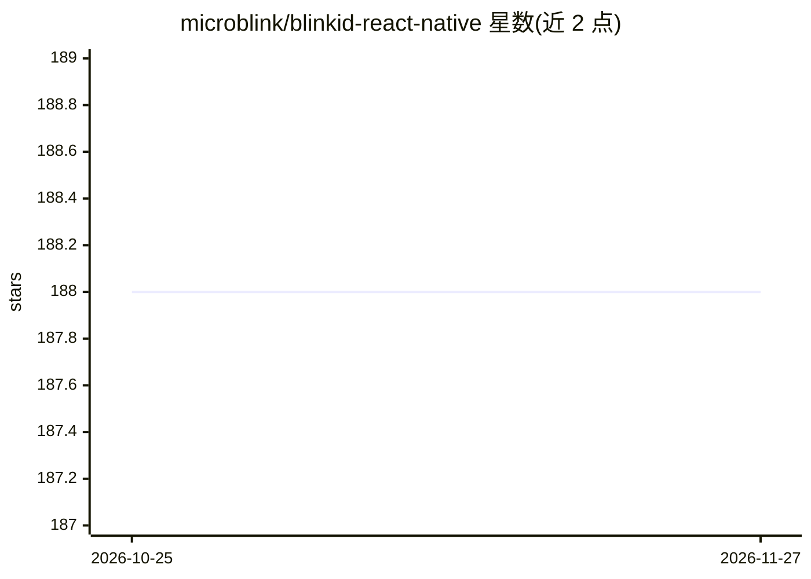

# microblink/blinkid-react-native

⭐ 188 · TypeScript · 推送 2026-11-04 · [GitHub](https://github.com/microblink/blinkid-react-native) · 组织维护

**React Native 应用中的身份证件扫描插件**

Microblink BlinkID SDK 的 React Native 封装，为跨平台应用提供证件扫描能力：支持相机实时扫描（默认 UX）与从静态 Base64 图片提取的 DirectAPI 两条路径，可配置文档捕获、条码、MRZ、VIZ 模块，支持按国家/地区/证件类型过滤与脱敏（redaction）规则。初始化需在 Microblink Developer Hub 注册获取许可证密钥。插件为开源封装，原生 SDK 以预编译框架/AAR 形式分发；README 注明要完整功能需使用原生 SDK。

## 筛选速览

| 维度 | 判定 | 备注 |
|---|---|---|
| AI 角色 | `ai-native` | 本体是模型或模型工具 |
| 许可风险 | `none` | — |
| 部署形态 | `library` | 以包/库形式分发 |
| 模型依赖 | — | README 未给出锁定关系 |
| 硬件要求 | — | 无带数字的原话,不猜 |
| 安装摩擦 | `low` | 无编译、无系统依赖或容器化 |
| 成熟度 | — | 结构信号不足 |

## 能力要点

- 相机扫描与静态图片 DirectAPI 两种扫描方式
- 文档捕获、条码、MRZ、VIZ 四个可独立开关的扫描模块
- 按国家/地区/证件类型的类别过滤与四种脱敏模式
- Android/iOS 双平台，附带示例应用与初始化脚本

## 适用场景

- 在金融类 App 的 KYC 流程中扫描身份证件
- 用户注册/入驻流程中采集证件信息
- 从相册图片中提取已拍证件的文字字段

## 场景标签

`文档解析` · 领域:知识与检索

## 证据(README 行号)

> L5: The BlinkID SDK is a comprehensive solution for implementing secure document scanning in React Native cross-platform
> L6: It offers powerful capabilities for capturing and analyzing a wide range of identification documents. The React Nati

## 星数曲线

2026-10-25 188 → 2026-11-27 188（+0）

---
*卡片 v1 · prompt 1.4 · 生成 2026-11-27 · 置信度 high · 依据 README sha `758ce65b4f9a` · [字段定义](../../DATASET.md)*
