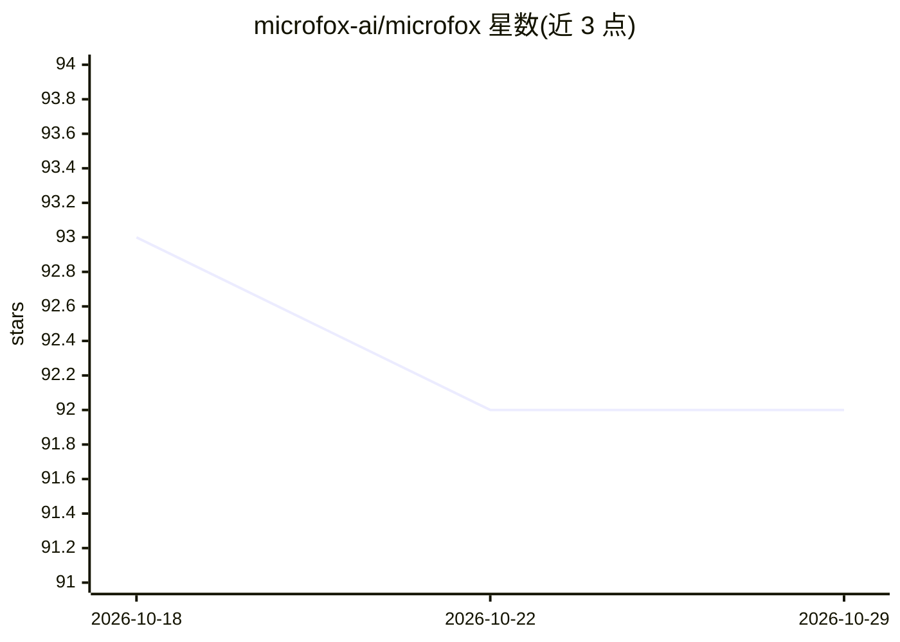

# microfox-ai/microfox

⭐ 92 · TypeScript · MIT · 推送 2026-10-02 · [GitHub](https://github.com/microfox-ai/microfox) · [官网](https://microfox.app) · 组织维护

**面向 AI agent 的微型 TypeScript SDK 集合，覆盖多平台 API 接入**

Microfox 是一组以 @microfox/ 为 scope 发布在 npm 上的开源 TypeScript 微型 SDK，帮助开发者将 Slack、Google Sheets、Instagram、WhatsApp Business、Notion 等平台集成到 AI agent、AI 工具或 SaaS 流水线中。项目配有自动化 SDK 生成系统：从 API 文档自动生成带 Zod 支持的 SDK，支持 REST、GraphQL、OAuth2 等 API 类型，自动生成文档与示例，并做编译测试与自动修复；为便于 AI agent 集成生成 embeddings 的功能标注为进行中。包按稳定度分为 Stable、OAuth Connectors、Semi-Stable 三档，覆盖 AWS SES、Reddit、YouTube、Google Calendar、Amazon Rekognition 人脸检测、Klingai、Veo on Vertex AI 等。

## 筛选速览

| 维度 | 判定 | 备注 |
|---|---|---|
| AI 角色 | `ai-ecosystem` | LLM/agent 周边工具 |
| 许可风险 | `permissive` | MIT |
| 部署形态 | `None` |  |
| 模型依赖 | — | README 未给出锁定关系 |
| 硬件要求 | — | 无带数字的原话,不猜 |
| 安装摩擦 | `low` | 无编译、无系统依赖或容器化 |
| 成熟度 | — | 结构信号不足 |

## 能力要点

- 自动化系统从 API 文档生成带 Zod 支持的 TypeScript SDK
- SDK 按 Stable / OAuth Connectors / Semi-Stable 分档发布
- 包体小（bytesized）以支持 serverless 环境
- SDK 覆盖 Slack、Google 系、Reddit、YouTube、WhatsApp Business 等数十个平台

## 适用场景

- 为 AI agent 或 AI 工具接入第三方平台 API
- 在 serverless 环境中轻量集成 OAuth 与 REST 服务
- 通过提交 API 文档 URL 请求自动生成新 SDK

## 场景标签

 · 领域:开发者工具/AI agent 基础设施

## 证据(README 行号)

> L18: Building Ai-agents, Ai-Tools or any new age SaaS would require it to be able to connect across platforms.
> L20: With Microfox SDKS, developers can easily integrate any platform into their pipelines authentically.
> L30: - Automatically generates TypeScript Micros SDKs (Zod supported) from API documentation

## 星数曲线

2026-10-18 93 → 2026-10-29 92（-1）

---
*卡片 v1 · prompt 1.4 · 生成 2026-10-23 · 置信度 high · 依据 README sha `bd5c22e3b357` · [字段定义](../../DATASET.md)*
