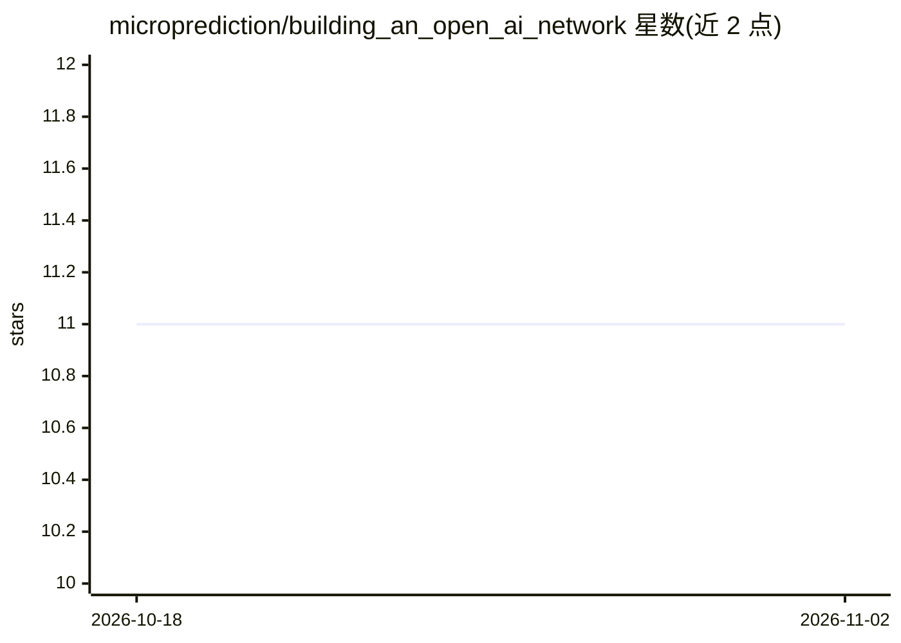

# microprediction/building_an_open_ai_network

⭐ 11 · MIT · 推送 2026-05-22 · [GitHub](https://github.com/microprediction/building_an_open_ai_network) · 个人维护

**MIT Press 书稿仓库：Building an Open AI Network**

同名书籍（MIT Press）的配套代码仓库，README 仅含一行指向网站视图的链接，未提供功能描述、安装步骤或使用说明。从仓库名与主题标签可判断其内容围绕 AI 网络、microprediction 与统计学展开，面向读者与研究者阅读书稿和代码。关键限制：README 信息量极低，能力与机制细节需以书籍网站为准，本编目仅基于仓库名称、出版社描述与主题标签。

## 筛选速览

| 维度 | 判定 | 备注 |
|---|---|---|
| AI 角色 | `ai-knowledge` | 知识聚合/清单类 |
| 许可风险 | `permissive` | MIT |
| 部署形态 | `None` |  |
| 模型依赖 | — | README 未给出锁定关系 |
| 硬件要求 | — | 无带数字的原话,不猜 |
| 安装摩擦 | `low` | 无编译、无系统依赖或容器化 |
| 成熟度 | — | 结构信号不足 |

## 能力要点

- MIT Press 出版书稿的配套仓库
- 主题标签：ai、microprediction、statistics
- README 提供网站视图入口

## 适用场景

- 阅读 Building an Open AI Network 书稿
- 获取书中 microprediction 相关代码与资料

## 场景标签

`教程课程` · 领域:学习与行业

## 证据(README 行号)

> L1: ## View as website

## 星数曲线

2026-10-18 11 → 2026-11-02 11（+0）

---
*卡片 v1 · prompt 1.4 · 生成 2026-11-02 · 置信度 low · 依据 README sha `ea41505cc18f` · [字段定义](../../DATASET.md)*
