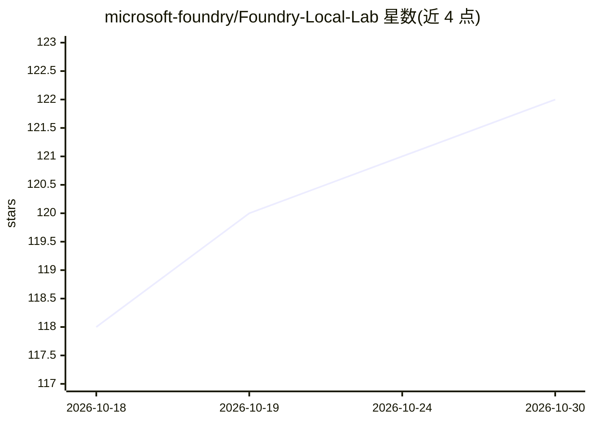

# microsoft-foundry/Foundry-Local-Lab

⭐ 122 · C# · MIT · 推送 2026-04-24 · [GitHub](https://github.com/microsoft-foundry/Foundry-Local-Lab) · 组织维护

**Foundry Local 本地 AI 应用开发动手工作坊（教程仓库）**

Microsoft 官方的实操教程仓库：教学如何在本机安装 Foundry Local 本地推理运行时（提供 OpenAI 兼容 API、无需云账号），并用 Python/JavaScript/C# 三种语言 SDK 构建应用。课程含 13 个部分：模型管理、RAG 流水线、单 Agent 与多 Agent 工作流、评测框架、Whisper 语音转录、ONNX Runtime GenAI 编译自定义/Hugging Face 模型、工具调用与 Web UI。提供各部分实验指南与三语言代码示例；含 50+ 语言翻译，可用 sparse checkout 精简克隆。

## 筛选速览

| 维度 | 判定 | 备注 |
|---|---|---|
| AI 角色 | `ai-knowledge` | 知识聚合/清单类 |
| 许可风险 | `permissive` | MIT |
| 部署形态 | `library` | 以包/库形式分发 |
| 模型依赖 | — | README 未给出锁定关系 |
| 硬件要求 | — | 无带数字的原话,不猜 |
| 安装摩擦 | `medium` | 含编译或系统依赖之一 |
| 成熟度 | — | 结构信号不足 |

## 能力要点

- 覆盖 RAG、单/多 Agent、评测、语音转录、工具调用等 13 个实验模块
- Python / JavaScript / C# 三语言对等代码示例
- 包含 ONNX Runtime GenAI 编译 Hugging Face 模型（如 Qwen3-0.6B）的端到端示例
- 含生产级示例应用 Zava Creative Writer（FastAPI / Node.js / .NET 实现）

## 适用场景

- 学习用 Foundry Local 在本机运行语言模型并构建 AI 应用
- 上手 RAG、多 Agent 工作流与评测驱动开发的实践练习
- 了解如何把 Hugging Face 模型编译为 ONNX 并接入本地运行时

## 场景标签

`教程课程` · 领域:学习与行业

## 证据(README 行号)

> L5: A hands-on workshop for running language models on your own machine and building intelligent applications with Found
> L7: > **What is Foundry Local?** Foundry Local is a lightweight runtime that lets you download, manage, and serve langua

## 星数曲线

2026-10-18 118 → 2026-10-30 122（+4）

---
*卡片 v1 · prompt 1.4 · 生成 2026-10-23 · 置信度 high · 依据 README sha `f628a0b270ca` · [字段定义](../../DATASET.md)*
