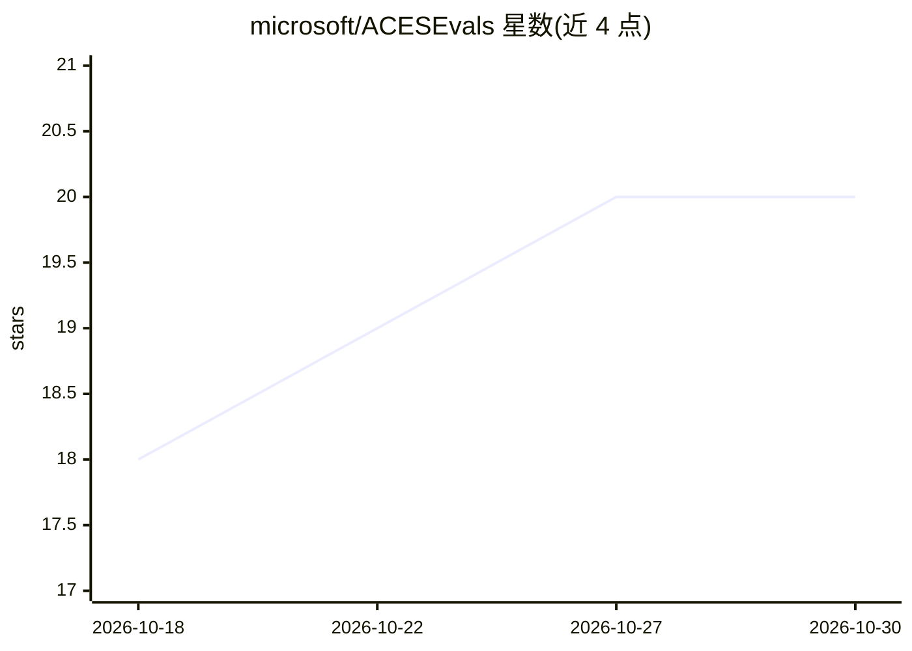

# microsoft/ACESEvals

⭐ 20 · Python · MIT · 推送 2026-09-15 · [GitHub](https://github.com/microsoft/ACESEvals) · 组织维护

**微软的 AI 安全 agent 基准评测库：评测网络安全智能体**

ACESEvals（内部代号 SABER）是基于 inspect_ai 框架的轻量 Python 评测库：读取 YAML 任务定义、渲染 Jinja2 提示词，生成原生 inspect_ai Task 对象，由 inspect eval CLI 在 Docker 沙箱中运行与计分。内置五个安全领域：Excytin 事件响应（599 题测试集、含 insane 模式）、CTI Realm 威胁情报、CRSBench 漏洞修补、CyBench CTF 挑战、SABER-Sim 模拟 Azure 靶场。支持 react/Copilot/Claude Code 三种 agent 线束，需 Docker、Python 3.11–3.12、uv 及 Azure OpenAI 或兼容端点。

## 筛选速览

| 维度 | 判定 | 备注 |
|---|---|---|
| AI 角色 | `ai-ecosystem` | LLM/agent 周边工具 |
| 许可风险 | `permissive` | MIT |
| 部署形态 | `self-host` | docker 或自建部署 |
| 模型依赖 | locked-api |  |
| 硬件要求 | — | 无带数字的原话,不猜 |
| 安装摩擦 | `low` | 无编译、无系统依赖或容器化 |
| 成熟度 | — | 结构信号不足 |

## 能力要点

- YAML 任务定义→inspect_ai Task 的转换层，Docker 沙箱与计分由 inspect_ai 处理
- 五个安全评测域：事件响应、威胁情报、漏洞修补、CTF、模拟 Azure 靶场
- 三种可切换 agent 线束：react、GitHub Copilot SDK、Claude Code CLI（沙箱内经桥接代理）
- Excytin insane 模式移除四类告警信号表，仅从原始遥测日志推理

## 适用场景

- 对 AI 安全 agent 做事件响应与威胁检测能力基准测试
- 比较不同模型或 agent 线束在 CTF、漏洞修补任务上的表现
- 在模拟 Azure 环境中评测红队、侦察、修复等安全任务

## 场景标签

`模型评测` `网络安全` · 领域:评测与运维

## 证据(README 行号)

> L5: A thin Python library for benchmarking AI security agents using YAML-driven task definitions and the inspect_ai eval
> L14: SABER loads YAML task definitions, renders Jinja2 prompts, and produces native inspect_ai `Task` objects. Docker sa

## 星数曲线

2026-10-18 18 → 2026-10-30 20（+2）

---
*卡片 v1 · prompt 1.4 · 生成 2026-10-28 · 置信度 mid · 依据 README sha `e40d20a5ef84` · [字段定义](../../DATASET.md)*
