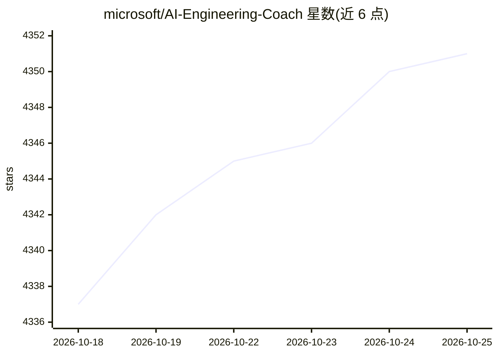

# microsoft/AI-Engineering-Coach

⭐ 4,351 · TypeScript · MIT · 推送 2026-10-24 · [GitHub](https://github.com/microsoft/AI-Engineering-Coach) · 组织维护

**分析本地 AI 编程助手会话日志的 VS Code 扩展仪表盘**

读取本地 AI 会话日志（不离开本机）并生成可操作洞察：练习评分与趋势、45 条可编辑反模式规则、按语言/工作区/模型/harness 统计的生成代码量、重复提示的技能发现、上下文健康检查，以及测验与成就等学习功能。面向使用 AI 编程助手的开发者，以 VS Code 扩展形式提供，需自行构建 .vsix 安装；也可在 GitHub Copilot 应用中以 canvas 运行，部分依赖本地语言模型的功能（Skill Finder、Learning Center、Context Health AI 审查）在 canvas 模式下隐藏。可选 AI 功能通过 VS Code 内置 Copilot 语言模型 API 实现，仅在用户显式调用时使用。

## 筛选速览

| 维度 | 判定 | 备注 |
|---|---|---|
| AI 角色 | `ai-ecosystem` | LLM/agent 周边工具 |
| 许可风险 | `permissive` | MIT |
| 部署形态 | `desktop` | 安装包/桌面程序 |
| 模型依赖 | — | README 未给出锁定关系 |
| 硬件要求 | — | 无带数字的原话,不猜 |
| 安装摩擦 | `low` | 无编译、无系统依赖或容器化 |
| 成熟度 | — | 结构信号不足 |

## 能力要点

- 45 条可编辑 markdown 反模式检测规则，带规则编辑器与规则 DSL 游乐场
- 按语言/工作区/模型/harness 统计 AI 生成代码量
- 从重复提示中发现可复用技能（Skill Finder）
- 本地只读分析，无遥测，数据不上传

## 适用场景

- 查看我使用 AI 编程助手的行为趋势与产出量
- 发现并改进提示词与上下文管理中的反模式
- 把重复的提示沉淀为可复用技能

## 场景标签

`提示工程` · 领域:Agent 开发

## 证据(README 行号)

> L15: AI Engineer Coach reads your local AI session logs and turns them into actionable insights — no data leaves your ma
> L18: - **Detect anti-patterns** -- 45 rules across prompt quality, session hygiene, code review, tool mastery, and conte
> L186: - **Optional AI features** — some features (rule compiler, skill finder, context review) use the VS Code built-in 

## 星数曲线

2026-10-18 4,337 → 2026-10-25 4,351（+14）

---
*卡片 v1 · prompt 1.4 · 生成 2026-10-20 · 置信度 high · 依据 README sha `3d1c757a94e8` · [字段定义](../../DATASET.md)*
