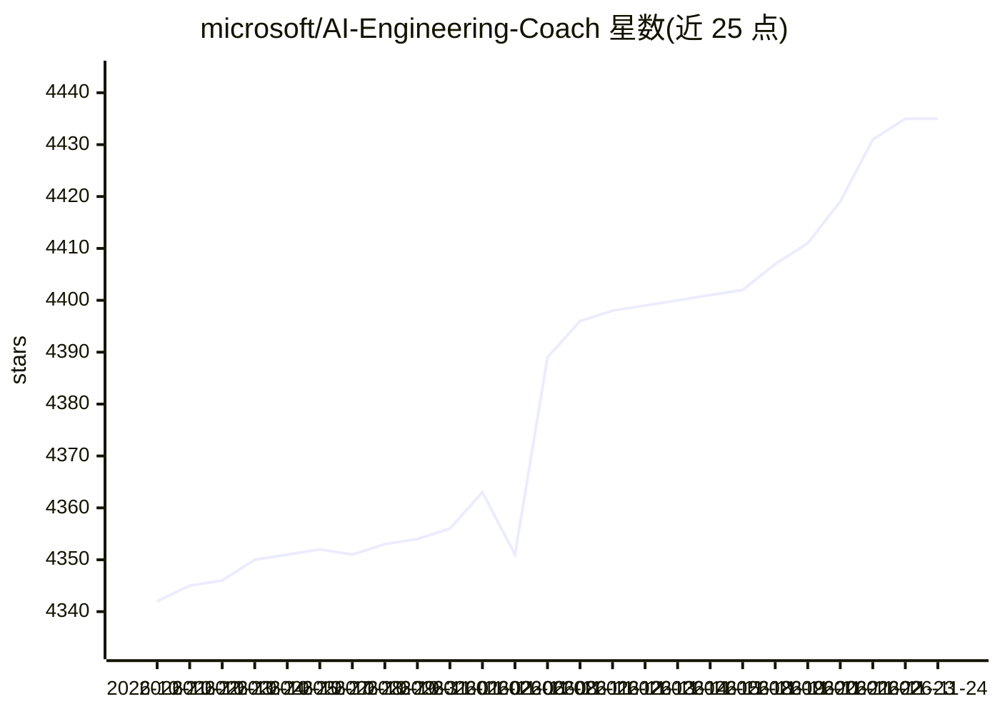

# microsoft/AI-Engineering-Coach

⭐ 4,440 · TypeScript · MIT · 推送 2026-11-23 · [GitHub](https://github.com/microsoft/AI-Engineering-Coach) · 组织维护

**分析本地 AI 编码会话日志的 VS Code 仪表盘扩展**

读取本机 AI 编码助手的会话日志，在不外传数据的前提下生成可视化洞察：练习得分与周趋势、45 条反模式检测规则（提示词质量、会话卫生、代码评审、工具掌握、上下文管理）、按语言/工作区/模型/harness 统计的生成代码量、重复提示词转化为可复用技能、上下文健康评分。以 VS Code 扩展形式分发，需自行构建 .vsix 安装；也可作为 canvas 运行在 GitHub Copilot 应用中。可选 AI 功能依赖 GitHub Copilot 的 VS Code 语言模型 API。

## 筛选速览

| 维度 | 判定 | 备注 |
|---|---|---|
| AI 角色 | `ai-ecosystem` | LLM/agent 周边工具 |
| 许可风险 | `permissive` | MIT |
| 部署形态 | `desktop` | 安装包/桌面程序 |
| 模型依赖 | — | README 未给出锁定关系 |
| 硬件要求 | — | 无带数字的原话,不猜 |
| 安装摩擦 | `low` | 无编译、无系统依赖或容器化 |
| 成熟度 | — | 结构信号不足 |

## 能力要点

- 45 条可编辑 markdown 规则的反模式检测与覆盖率热图
- 按语言、工作区、模型、harness 统计 AI 生成代码量
- 本地只读分析，无遥测，数据不离开本机
- 同一 webview 可作为 canvas 运行于 GitHub Copilot 应用

## 适用场景

- 追踪自己和团队的 AI 编码助手使用习惯与进步趋势
- 检测提示词和会话管理中的反模式并改进
- 把反复出现的提示词沉淀为可复用技能
- 评估工作区的 agent 就绪度与上下文文件质量

## 场景标签

 · 领域:开发者工具/AI 编码分析

## 证据(README 行号)

> L15: AI Engineer Coach reads your local AI session logs and turns them into actionable insights — no data leaves your ma
> L18: - **Detect anti-patterns** -- 45 rules across prompt quality, session hygiene, code review, tool mastery, and conte
> L221: - **Optional AI features** — some features (rule compiler, skill finder, Level Up learning content, context review

## 星数曲线

2026-10-21 4,342 → 2026-11-24 4,435（+93）

---
*卡片 v1 · prompt 1.4 · 生成 2026-11-24 · 置信度 high · 依据 README sha `e856260606fb` · [字段定义](../../DATASET.md)*
