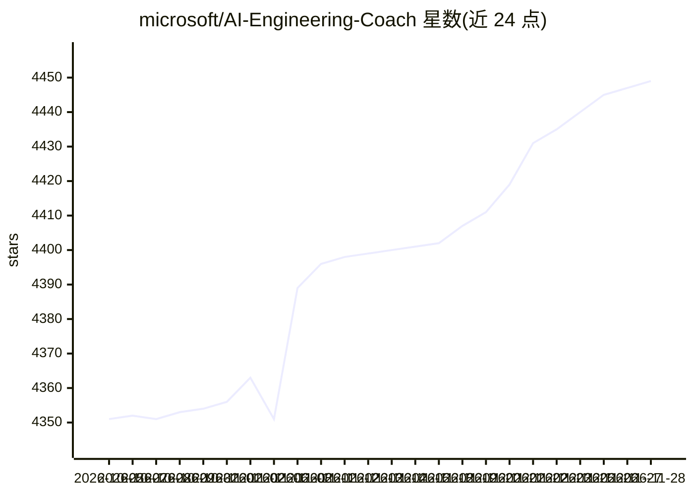

# microsoft/AI-Engineering-Coach

⭐ 4,449 · TypeScript · MIT · 推送 2026-11-27 · [GitHub](https://github.com/microsoft/AI-Engineering-Coach) · 组织维护

**分析本地 AI 编码助手使用日志的开发者教练仪表盘**

微软出品的 VS Code 扩展与 GitHub Copilot 应用画布，读取本地 AI 会话日志并在本机完成解析与统计，数据不出机器。提供练习得分与趋势追踪、45 条反模式规则检测、按语言/工作区/模型统计生成代码量、代理自治与会话委派分析、重复提示转技能发现、上下文健康评分等功能。扩展未上架市场，需自行构建 .vsix 安装；部分 AI 功能依赖 VS Code 语言模型 API 中的 Copilot Auto 模型。

## 筛选速览

| 维度 | 判定 | 备注 |
|---|---|---|
| AI 角色 | `ai-enhanced` | 去掉 AI 部分产品仍成立 |
| 许可风险 | `permissive` | MIT |
| 部署形态 | `desktop` | 安装包/桌面程序 |
| 模型依赖 | — | README 未给出锁定关系 |
| 硬件要求 | — | 无带数字的原话,不猜 |
| 安装摩擦 | `low` | 无编译、无系统依赖或容器化 |
| 成熟度 | — | 结构信号不足 |

## 能力要点

- 45 条可编辑规则检测提示质量、会话卫生、代码评审、工具掌握与上下文管理反模式
- 本地只读解析会话日志，无遥测，数据不出机器
- 同一仪表盘可作为 VS Code 扩展或 GitHub Copilot 应用画布运行
- Skill Finder 将重复提示模式转为可复用技能

## 适用场景

- 追踪自己与 AI 编码助手的协作模式和产出量
- 检测并改进提示词与上下文管理中的坏习惯
- 从重复提示中沉淀团队可复用的技能

## 场景标签

`提示工程` `数据分析` · 领域:Agent 开发

## 证据(README 行号)

> L15: AI Engineer Coach reads your local AI session logs and turns them into actionable insights — no data leaves your ma
> L230: - **Optional AI features** — some features (rule compiler, skill finder, Level Up learning content, context review

## 星数曲线

2026-10-25 4,351 → 2026-11-28 4,449（+98）

---
*卡片 v1 · prompt 1.4 · 生成 2026-11-28 · 置信度 high · 依据 README sha `b9f7505d8a92` · [字段定义](../../DATASET.md)*
