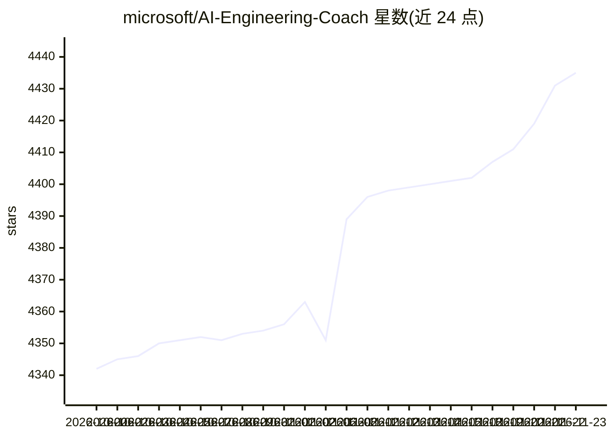

# microsoft/AI-Engineering-Coach

⭐ 4,435 · TypeScript · MIT · 推送 2026-11-22 · [GitHub](https://github.com/microsoft/AI-Engineering-Coach) · 组织维护

**给开发者用的 AI 编码助手使用分析仪表盘**

VS Code 扩展（1.115+，MIT），读取本地 AI 编码会话日志并生成洞察仪表盘：练习得分与周趋势、45 条反模式规则检测（提示质量、会话卫生、代码评审、工具掌握、上下文管理）、按语言/模型/harness 统计 AI 生成代码量、把重复提示转化为可复用技能、上下文健康评分。所有解析与分析在本机完成，只读不改会话文件。未发布到市场，需自行构建 .vsix 安装；也可作为 GitHub Copilot 应用的 canvas 运行。

## 筛选速览

| 维度 | 判定 | 备注 |
|---|---|---|
| AI 角色 | `ai-ecosystem` | LLM/agent 周边工具 |
| 许可风险 | `permissive` | MIT |
| 部署形态 | `desktop` | 安装包/桌面程序 |
| 模型依赖 | — | README 未给出锁定关系 |
| 硬件要求 | — | 无带数字的原话,不猜 |
| 安装摩擦 | `low` | 无编译、无系统依赖或容器化 |
| 成熟度 | — | 结构信号不足 |

## 能力要点

- 45 条可编辑的反模式检测规则及覆盖率热图
- 按语言、工作区、模型、harness 统计 AI 生成代码量
- Skill Finder 将重复提示匹配开源技能目录
- 本地只读分析，无专有遥测，数据不出机器

## 适用场景

- 回顾自己使用 AI 编码助手的习惯并改进提示质量
- 团队查看 AI 生成代码量与工作时段分布
- 把高频重复提示整理成可复用技能

## 场景标签

`提示工程` · 领域:Agent 开发

## 证据(README 行号)

> L15: AI Engineer Coach reads your local AI session logs and turns them into actionable insights — no data leaves your ma
> L186: - **Optional AI features** — some features (rule compiler, skill finder, Level Up learning content, context review

## 星数曲线

2026-10-20 4,342 → 2026-11-23 4,435（+93）

---
*卡片 v1 · prompt 1.4 · 生成 2026-11-22 · 置信度 high · 依据 README sha `4098181ce4bd` · [字段定义](../../DATASET.md)*
