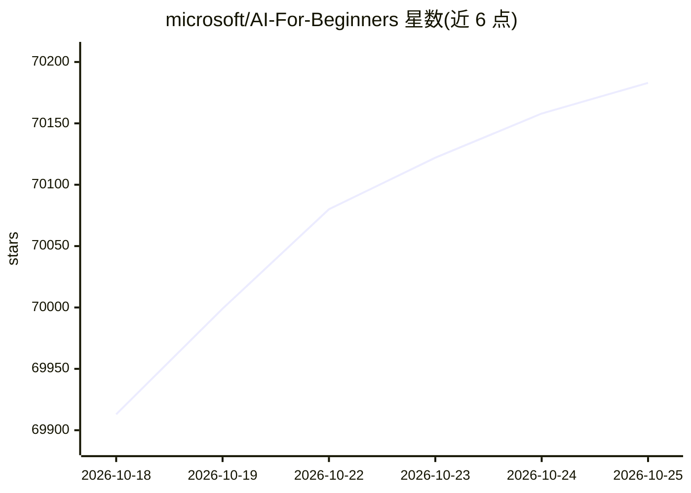

# microsoft/AI-For-Beginners

⭐ 70,241 · Jupyter Notebook · MIT · 推送 2026-10-23 · [GitHub](https://github.com/microsoft/AI-For-Beginners) · 组织维护

**面向 AI 初学者的 12 周 24 课系统课程**

微软出品的 12 周、24 课时人工智能入门课程，内容含符号 AI（知识表示与推理）、神经网络与深度学习、计算机视觉、自然语言处理、遗传算法、多智能体系统与 AI 伦理等模块，每课提供 Jupyter Notebook、测验和实验，代码以 PyTorch 与 TensorFlow 双框架呈现。仓库含 50+ 语言自动翻译、本地/ Codespace 运行指引与可本地部署的测验应用，课程明确不覆盖经典机器学习、业务 AI 与云平台实操等主题。

## 筛选速览

| 维度 | 判定 | 备注 |
|---|---|---|
| AI 角色 | `ai-knowledge` | 知识聚合/清单类 |
| 许可风险 | `permissive` | MIT |
| 部署形态 | `None` |  |
| 模型依赖 | — | README 未给出锁定关系 |
| 硬件要求 | — | 无带数字的原话,不猜 |
| 安装摩擦 | `low` | 无编译、无系统依赖或容器化 |
| 成熟度 | — | 结构信号不足 |

## 动量与使用信号

- 维护:`active` — 距上次 push 31.5 天,年发版 0,85 位贡献者
- 涨星:近 1 天 **+65**(自 20261016 起算)
- 平台:WINDOWS / MACOS / LINUX · 协议:MCP

## 能力要点

- 24 课时覆盖符号 AI 到 LLM 的完整路径
- 每课含可执行 Jupyter Notebook，支持 PyTorch/TensorFlow/Keras 双框架
- 50+ 语言翻译由 GitHub Action 自动维护
- 附测验应用（可本地运行或部署至 Azure）与实验 Lab

## 适用场景

- 系统自学人工智能与深度学习基础知识
- 教师获取现成的 AI 课程大纲与实验材料
- 通过 Notebook 上手 PyTorch 或 TensorFlow

## 场景标签

`教程课程` · 领域:学习与行业

## 证据(README 行号)

> L21: Explore the world of **Artificial Intelligence** (AI) with our 12-week, 24-lesson curriculum! It includes practical
> L64: * Different approaches to Artificial Intelligence, including the "good old" symbolic approach with **Knowledge Repr
> L124: * Executable Jupyter Notebooks, which are often specific to the framework (**PyTorch** or **TensorFlow**). The exe

## 星数曲线

2026-10-18 69,913 → 2026-10-25 70,183（+270）

---
*卡片 v1 · prompt 1.4 · 生成 2026-10-18 · 置信度 high · 依据 README sha `b1bc6ba59b03` · [字段定义](../../DATASET.md)*
