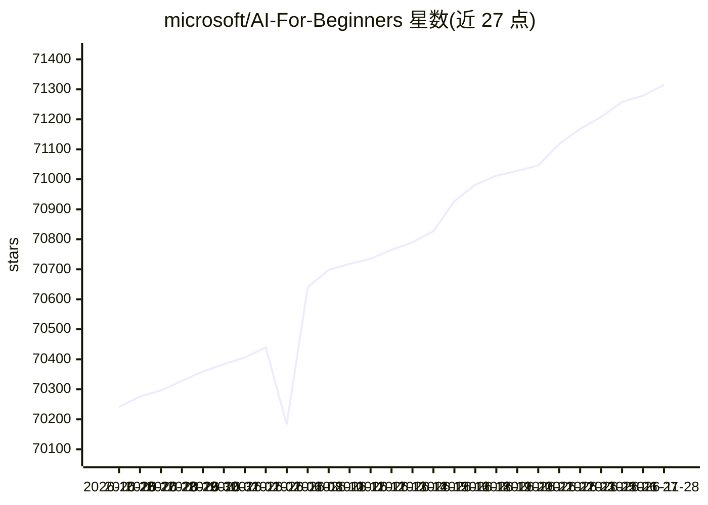

# microsoft/AI-For-Beginners

⭐ 71,315 · Jupyter Notebook · MIT · 推送 2026-11-15 · [GitHub](https://github.com/microsoft/AI-For-Beginners) · 组织维护

**面向初学者的 12 周 24 课时 AI 课程**

微软出品的 AI 入门课程仓库：12 周 24 课时，覆盖符号式 AI（知识表示与推理）、神经网络与深度学习（用 PyTorch/TensorFlow 代码演示）、计算机视觉（CNN、目标检测、分割、GAN）、NLP（RNN、Transformer、BERT、LLM）、遗传算法、多智能体系统与 AI 伦理。每课含预习材料、可运行 Jupyter Notebook、部分含 Lab，另有测验应用（可本地运行或部署到 Azure）。明确不覆盖经典机器学习、Azure 认知服务应用、聊天机器人与深层数学。

## 筛选速览

| 维度 | 判定 | 备注 |
|---|---|---|
| AI 角色 | `ai-knowledge` | 知识聚合/清单类 |
| 许可风险 | `permissive` | MIT |
| 部署形态 | `None` |  |
| 模型依赖 | — | README 未给出锁定关系 |
| 硬件要求 | — | 无带数字的原话,不猜 |
| 安装摩擦 | `low` | 无编译、无系统依赖或容器化 |
| 成熟度 | — | 结构信号不足 |

## 动量与使用信号

- 维护:`active` — 距上次 push 31.5 天,年发版 0,85 位贡献者
- 涨星:近 1 天 **+65**(自 20261016 起算)
- 平台:WINDOWS / MACOS / LINUX · 协议:MCP

## 能力要点

- 24 课时含可运行 Jupyter Notebook 与 Lab
- 代码示例基于 PyTorch 与 TensorFlow 两个框架
- 提供 50+ 语言翻译与 Binder 在线运行入口
- 测验应用可本地运行或部署到 Azure

## 适用场景

- AI 初学者系统学习神经网络、计算机视觉与 NLP
- 教师找现成课程结构与 Lab 用于教学
- 想通过 Notebook 动手实践理解 AI 概念的学习者

## 场景标签

`教程课程` · 领域:学习与行业

## 证据(README 行号)

> L21: Explore the world of **Artificial Intelligence** (AI) with our 12-week, 24-lesson curriculum! It includes practical
> L64: * Different approaches to Artificial Intelligence, including the "good old" symbolic approach with **Knowledge Repr
> L84: ||Lesson Link|PyTorch/Keras/TensorFlow|Lab|

## 星数曲线

2026-10-26 70,241 → 2026-11-28 71,315（+1,074）

---
*卡片 v1 · prompt 1.4 · 生成 2026-11-22 · 置信度 high · 依据 README sha `edbaf86714c9` · [字段定义](../../DATASET.md)*
