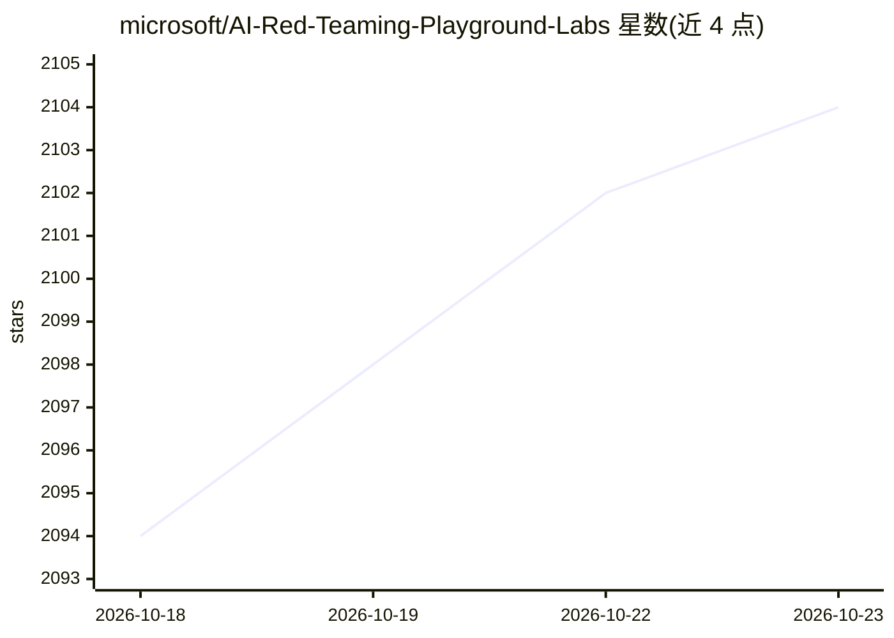

# microsoft/AI-Red-Teaming-Playground-Labs

⭐ 2,104 · TypeScript · MIT · 推送 2026-02-13 · [GitHub](https://github.com/microsoft/AI-Red-Teaming-Playground-Labs) · 组织维护

**面向安全专业人员的 AI 红队训练挑战实验环境**

微软团队为 Black Hat USA 2024 课程 "AI Red Teaming in Practice" 设计的 12 个红队挑战实验：覆盖直接/间接提示注入、元提示提取、多轮 Crescendo 攻击与绕过护栏等场景。基于 Chat Copilot 改造的实验环境，通过 Docker Compose 一键启动，需接入 Azure OpenAI 或 OpenAI API；配套 PyRIT Jupyter Notebook 自动化解法（Lab 1/5）。附 CTFd、评分、负载均衡等可选组件与 Kubernetes 部署参考文件。

## 筛选速览

| 维度 | 判定 | 备注 |
|---|---|---|
| AI 角色 | `ai-knowledge` | 知识聚合/清单类 |
| 许可风险 | `permissive` | MIT |
| 部署形态 | `self-host` | docker 或自建部署 |
| 模型依赖 | locked-api |  |
| 硬件要求 | — | 无带数字的原话,不猜 |
| 安装摩擦 | `low` | 无编译、无系统依赖或容器化 |
| 成熟度 | — | 结构信号不足 |

## 能力要点

- 12 个挑战覆盖提示注入、元提示提取、多轮攻击与绕过护栏
- Docker Compose 一键启动完整实验环境，支持 Azure OpenAI 与 OpenAI API 两种后端
- 配套 PyRIT Jupyter Notebook 展示自动化攻击解法
- 附 CTFd 计分、chat-score 评审与 Kubernetes 部署参考组件

## 适用场景

- 我需要为安全团队组织 AI 红队实操培训
- 我想练习针对生成式 AI 系统的提示注入攻击与防御
- 我想学习用 PyRIT 自动化复现红队攻击

## 场景标签

`教程课程` `网络安全` · 领域:学习与行业

## 证据(README 行号)

> L3: This repository contains the challenges for the labs used in the course "AI Red Teaming in Practice". The course was
> L5: These challenges are also referenced in the Microsoft Learn Limited Series: AI Red Teaming 101, released on July 9, 

## 星数曲线

2026-10-18 2,094 → 2026-10-23 2,104（+10）

---
*卡片 v1 · prompt 1.4 · 生成 2026-10-21 · 置信度 mid · 依据 README sha `ca19bf59ee63` · [字段定义](../../DATASET.md)*
