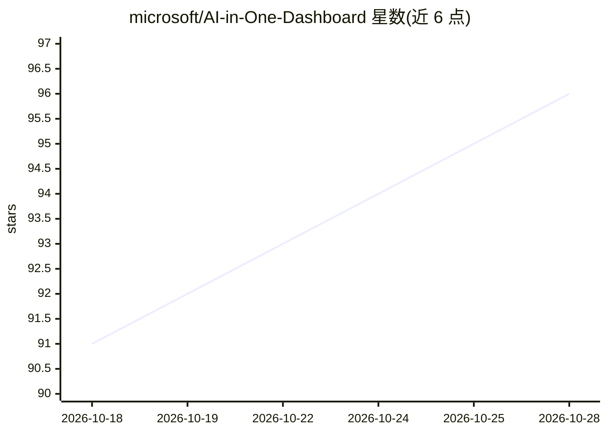

# microsoft/AI-in-One-Dashboard

⭐ 96 · JavaScript · MIT · 推送 2026-10-27 · [GitHub](https://github.com/microsoft/AI-in-One-Dashboard) · [官网](https://aka.ms/Analytics-Hub) · 组织维护

**面向企业 AI 决策者的 M365 Copilot/Agent 采用度 Power BI 看板**

微软发布的免费 Power BI 模板，读取 PAX（Portable Audit eXporter）脚本从 Microsoft Purview、Entra/MAC、Agent 365 预处理出的 rollup CSV，展示近 20 页关于 M365 Copilot、Copilot Chat 与 Agent 的使用、采用、习惯、健康度与许可报告。提供 3-in-1 自动检测版（本地/SharePoint/OneLake）与 SharePoint 版（支持 Service 定时刷新），内置行级安全与隐私控制；附合成示例数据与独立处理脚本。限制：不能读原始 Purview/Entra 导出文件，需租户开启统一审计日志，当前仅英文，且标注为实验性模板。

## 筛选速览

| 维度 | 判定 | 备注 |
|---|---|---|
| AI 角色 | `ai-ecosystem` | LLM/agent 周边工具 |
| 许可风险 | `permissive` | MIT |
| 部署形态 | `self-host` | docker 或自建部署 |
| 模型依赖 | — | README 未给出锁定关系 |
| 硬件要求 | — | 无带数字的原话,不猜 |
| 安装摩擦 | `low` | 无编译、无系统依赖或容器化 |
| 成熟度 | `idea` | |

## 能力要点

- 读取 PAX 预处理的 rollup 文件，展示 Copilot/Agent 采用度与许可分析
- 双版本：3-in-1 自动检测（本地/SharePoint/OneLake）与支持定时刷新的 SharePoint 版
- 预处理在上游完成，官方称 Power BI 加载时间通常减少约 80%
- 附无租户可用的合成示例数据与独立处理器脚本

## 适用场景

- 我作为 AI 或业务负责人，想统一查看组织内 Copilot 和 Agent 的使用与采用情况
- 我想优化 AI 许可分配和员工赋能投入
- 我想在 Power BI Service 中定时刷新 AI 采用度报表

## 场景标签

`数据分析` · 领域:效率与自动化

## 证据(README 行号)

> L3: ### One Power BI dashboard for all Microsoft Copilot and Agent adoption signals.
> L148: - **Comprehensive visibility into M365 Copilot, unlicensed Copilot Chat, and Agent usage** across your organizatio
> L144: ## 📊 What This Dashboard Provides

## 星数曲线

2026-10-18 91 → 2026-10-28 96（+5）

---
*卡片 v1 · prompt 1.4 · 生成 2026-10-23 · 置信度 mid · 依据 README sha `bae2657051a8` · [字段定义](../../DATASET.md)*
