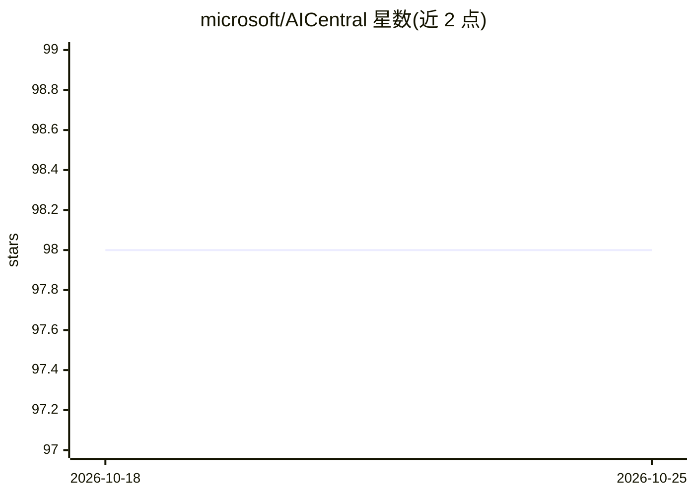

# microsoft/AICentral

⭐ 98 · C# · MIT · 推送 2026-08-24 · [GitHub](https://github.com/microsoft/AICentral) · 组织维护

**面向多 OpenAI 服务的 .NET AI 网关：代理、鉴权与监控**

基于 ASP.NET Core（dotnet 8）的 AI 服务控制中心：作为代理运行在客户端与下游 AI 服务之间，将 Azure OpenAI 与 OpenAI 等下游呈现为统一上游端点，提供智能路由（容量优先/随机/优先级/最低延迟）、熔断与重试、消费者级 OAuth2 鉴权与临时 JWT 签发、本地与分布式（Redis）令牌/请求限流、PII 脱敏日志、OpenTelemetry 指标输出，并支持 DAPR 广播与 Azure AI Search 向量化扩展。部署方式包括 Docker 容器、NuGet 包嵌入 ASP.NET Core 应用及 Azure Bicep/ARM 模板。

## 筛选速览

| 维度 | 判定 | 备注 |
|---|---|---|
| AI 角色 | `ai-ecosystem` | LLM/agent 周边工具 |
| 许可风险 | `permissive` | MIT |
| 部署形态 | `self-host` | docker 或自建部署 |
| 模型依赖 | locked-api |  |
| 硬件要求 | — | 无带数字的原话,不猜 |
| 安装摩擦 | `low` | 无编译、无系统依赖或容器化 |
| 成熟度 | — | 结构信号不足 |

## 能力要点

- 智能路由：容量优先、优先级回退、最低延迟等多种端点选择器
- 消费者级鉴权、临时 JWT 签发与本地/分布式限流（Redis）
- OpenTelemetry 指标（含流式响应令牌计数）与 PII 脱敏日志
- 插件式扩展模型，支持 DAPR 广播、Azure Monitor 日志等扩展

## 适用场景

- 统一代理与治理多个 Azure OpenAI / OpenAI 下游服务
- 按消费者维度做限流与用量计量（如 PTU 计费回收）
- 黑客松等场景签发限时 JWT 控制预算
- 为现有 SDK 客户端透明接入监控与弹性重试

## 场景标签

`模型网关` `LLM 可观测性` · 领域:Agent 开发

## 证据(README 行号)

> L9: ## Take control of your AI services.
> L24: - Intelligent Routing
> L119: This sample produces a AI-Central proxy that

## 星数曲线

2026-10-18 98 → 2026-10-25 98（+0）

---
*卡片 v1 · prompt 1.4 · 生成 2026-10-23 · 置信度 high · 依据 README sha `972809ccb231` · [字段定义](../../DATASET.md)*
