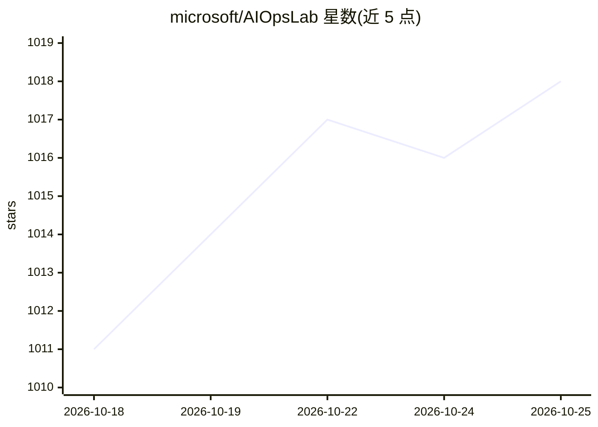

# microsoft/AIOpsLab

⭐ 1,019 · Python · MIT · 推送 2026-10-24 · [GitHub](https://github.com/microsoft/AIOpsLab) · 组织维护

**微软的 AIOps 智能体设计、开发与评测框架及基准套件**

面向 AIOps 自主智能体的完整框架：可部署微服务云环境（kind 本地集群、远程 K8s、Azure VM Terraform+Ansible）、注入故障、生成工作负载并导出遥测数据，由编排器管理智能体与环境的交互并评估其解法。内置基准问题套件，可扩展自定义应用与问题。智能体以 Python 类加 get_action 方法接入，任意框架均可；附带 GPT-4 基线、vLLM、Azure OpenAI 等预集成客户端。需要 Python 3.11、Helm 与 K8s 集群。

## 筛选速览

| 维度 | 判定 | 备注 |
|---|---|---|
| AI 角色 | `ai-ecosystem` | LLM/agent 周边工具 |
| 许可风险 | `permissive` | MIT |
| 部署形态 | `library` | 以包/库形式分发 |
| 模型依赖 | local-ok | 支持本地模型 |
| 硬件要求 | — | 无带数字的原话,不猜 |
| 安装摩擦 | `low` | 无编译、无系统依赖或容器化 |
| 成熟度 | — | 结构信号不足 |

## 能力要点

- 部署微服务云环境、注入故障、生成工作负载、导出遥测数据的编排框架
- 内置可扩展的 AIOps 基准问题套件
- 三步接入任意框架开发的智能体（Python 类 + get_action 方法）
- 支持 kind 本地集群、远程 K8s、Azure VM（Terraform+Ansible）三种部署方式

## 适用场景

- 我在标准化云环境中评测自己的 AIOps 智能体
- 我需要可复现、标准化的智能体运维基准做研究对比
- 我想为自定义微服务应用设计故障检测/缓解问题

## 场景标签

`模型评测` · 领域:评测与运维

## 证据(README 行号)

> L17: AIOpsLab is a holistic framework to enable the design, development, and evaluation of autonomous AIOps agents that,
> L19: Moreover, AIOpsLab provides a built-in benchmark suite with a set of problems to evaluate AIOps agents in an intera

## 星数曲线

2026-10-18 1,011 → 2026-10-25 1,018（+7）

---
*卡片 v1 · prompt 1.4 · 生成 2026-10-21 · 置信度 high · 依据 README sha `35b48c211092` · [字段定义](../../DATASET.md)*
