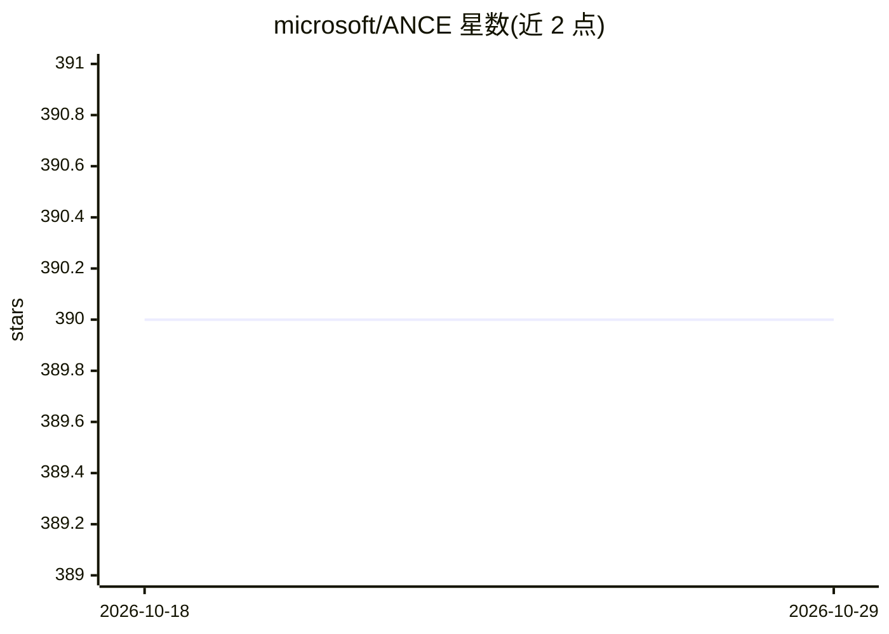

# microsoft/ANCE

⭐ 390 · Python · MIT · 推送 2026-01-06 · [GitHub](https://github.com/microsoft/ANCE) · 组织维护

**密集检索训练算法代码：用 ANN 索引构造负例训练 BERT 检索模型**

微软发布的论文复现代码：实现 ANCE（Approximate Nearest Neighbor Negative Contrastive Learning）训练机制，从与训练过程并行更新的语料 ANN 索引中构造负例，用于训练 BERT-Siamese 密集检索模型。流程包括数据下载与预处理、BM25 warmup checkpoint 训练、ANN 数据生成与训练两个并行作业、推理与基于 Jupyter notebook 的评测（NDCG/MRR/Recall），并给出 MSMARCO 与 TREC DL 基准结果及 checkpoint 下载。基于 PyTorch 分布式训练，面向信息检索研究人员。

## 筛选速览

| 维度 | 判定 | 备注 |
|---|---|---|
| AI 角色 | `ai-native` | 本体是模型或模型工具 |
| 许可风险 | `permissive` | MIT |
| 部署形态 | `None` |  |
| 模型依赖 | — | README 未给出锁定关系 |
| 硬件要求 | — | 无带数字的原话,不猜 |
| 安装摩擦 | `low` | 无编译、无系统依赖或容器化 |
| 成熟度 | — | 结构信号不足 |

## 能力要点

- 从并行更新的 ANN 索引构造负训练实例的训练机制
- 提供 warmup 训练、ANN 数据生成、推理与评测完整流程命令
- 覆盖 MSMARCO 段落/文档与 OpenQA（NQ/TriviaQA）基准
- 提供结果 checkpoint、检索结果与查询嵌入下载

## 适用场景

- 复现论文中 TREC DL 2019 与 OpenQA 检索实验
- 训练密集文本检索模型用于段落/文档检索
- 研究负例采样策略对密集检索训练的影响

## 场景标签

`语义搜索` `微调` · 领域:知识与检索

## 证据(README 行号)

> L4: This repo provides the code for reproducing the experiments in Approximate Nearest Neighbor Negative Contrastive Lea
> L10: paper presents Approximate nearest neighbor Negative Contrastive Estimation
> L11: (ANCE), a training mechanism that constructs negatives from an Approximate

## 星数曲线

2026-10-18 390 → 2026-10-29 390（+0）

---
*卡片 v1 · prompt 1.4 · 生成 2026-10-21 · 置信度 high · 依据 README sha `5a355af48eaf` · [字段定义](../../DATASET.md)*
