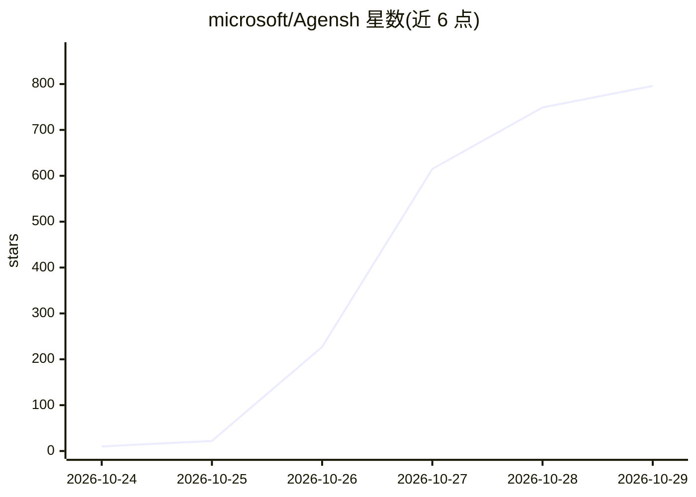

# microsoft/Agensh

⭐ 796 · Python · MIT · 推送 2026-10-28 · [GitHub](https://github.com/microsoft/Agensh) · [官网](https://aka.ms/Agensh) · 组织维护

**去中心化可扩展至 1024 个 agent 的多智能体协同框架**

微软开源的自组织多智能体 harness：agent 自主发现并认领子任务、共享发现、验证结果并异步合并进度，无中央调度器，通过共享工作区、消息接口与共享上下文连接各 agent，规模可达 1024 个 agent。共享工作区基于 Gitea，消息接口基于 Mattermost，实验中集成于 Copilot harness 的 per-agent agentic loop 之上。以论文形式发表（arXiv），提供单节点 Docker Compose 团队配置与单 agent 基线的复现实验装置。

## 筛选速览

| 维度 | 判定 | 备注 |
|---|---|---|
| AI 角色 | `ai-ecosystem` | LLM/agent 周边工具 |
| 许可风险 | `permissive` | MIT |
| 部署形态 | `self-host` | docker 或自建部署 |
| 模型依赖 | — | README 未给出锁定关系 |
| 硬件要求 | — | 无带数字的原话,不猜 |
| 安装摩擦 | `low` | 无编译、无系统依赖或容器化 |
| 成熟度 | — | 结构信号不足 |

## 能力要点

- 无中央调度器的自组织协作循环：认领子任务→行动→验证→异步合并
- 规模可扩展至 1,024 个并发 agent
- 共享工作区（Gitea）+ 消息接口（Mattermost）+ 共享上下文（改编自 DeLM）
- 提供 Docker Compose 单节点实验复现装置与单 agent 基线

## 适用场景

- 研究大规模多 agent 协作与涌现的分工/协调行为
- 复现 ProgramBench/Pandoc 等程序重建实验
- 作为多 agent 实验的 harness 底座做扩展研究

## 场景标签

`多智能体` `Agent 框架` · 领域:Agent 开发

## 证据(README 行号)

> L17: **Agensh is a self-organized multi-agent harness that scales to 1,024 agents.**
> L56: In our experiments, we integrate Agensh on top of the per-agent agentic loop

## 星数曲线

2026-10-24 10 → 2026-10-29 796（+786）

---
*卡片 v1 · prompt 1.4 · 生成 2026-10-25 · 置信度 high · 依据 README sha `b0f79bd47413` · [字段定义](../../DATASET.md)*
