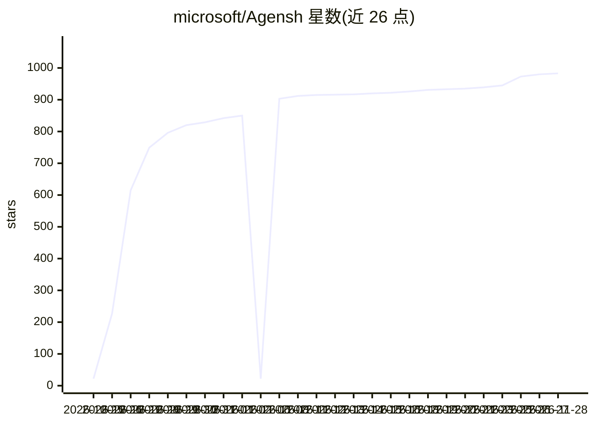

# microsoft/Agensh

⭐ 983 · Python · MIT · 推送 2026-11-03 · [GitHub](https://github.com/microsoft/Agensh) · [官网](https://aka.ms/Agensh) · 组织维护

**可扩展至 1,024 个 agent 的去中心化多智能体编排框架**

Agensh 定义了一个多智能体协作循环：worker 并发地收集上下文、认领子任务、执行动作、验证结果并异步合并进度，通过共享工作区（Gitea）、消息接口（Mattermost）与共享上下文（改编自 DeLM）连接，无需中央编排器。支持 Copilot、Codex、Claude Code、Pi 作为底层单 agent 后端，通过 ACP 暴露接口。发布内容包括 Docker Compose 单节点团队配置、单 agent 基线、实验复现指南与评估工具，附带 arXiv 论文。MIT 许可。

## 筛选速览

| 维度 | 判定 | 备注 |
|---|---|---|
| AI 角色 | `ai-ecosystem` | LLM/agent 周边工具 |
| 许可风险 | `permissive` | MIT |
| 部署形态 | `self-host` | docker 或自建部署 |
| 模型依赖 | — | README 未给出锁定关系 |
| 硬件要求 | — | 无带数字的原话,不猜 |
| 安装摩擦 | `low` | 无编译、无系统依赖或容器化 |
| 成熟度 | — | 结构信号不足 |

## 能力要点

- 自组织多智能体协作循环：认领子任务/验证/合并进度，无中央编排器
- 可扩展至 1,024 个 agent，通过 Gitea 共享工作区与 Mattermost 消息接口协作
- 支持 Copilot/Codex/Claude Code/Pi 四种单 agent 后端，经 ACP 与适配器接入
- 提供 Docker Compose 单节点部署与实验复现、评估、恢复流程

## 适用场景

- 在自有软件仓库上运行多 agent 团队协作完成任务
- 复现论文中关于多 agent 规模化效果的实验
- 研究自组织 agent 团队中涌现的协作流程与角色分化

## 场景标签

`多智能体` · 领域:Agent 开发

## 证据(README 行号)

> L19: **Agensh is a self-organized multi-agent harness that scales to 1,024 agents.**
> L50: **Agensh defines the multi-agent cooperation loop.**
> L66: This release includes a single-node team setup using Docker Compose and a

## 星数曲线

2026-10-25 22 → 2026-11-28 983（+961）

---
*卡片 v1 · prompt 1.4 · 生成 2026-11-24 · 置信度 high · 依据 README sha `ed1c55f94ca5` · [字段定义](../../DATASET.md)*
